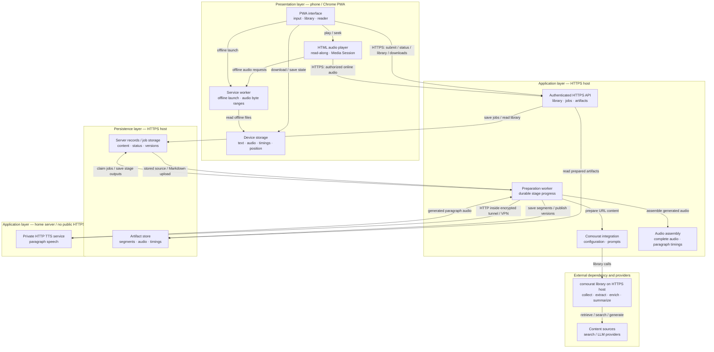
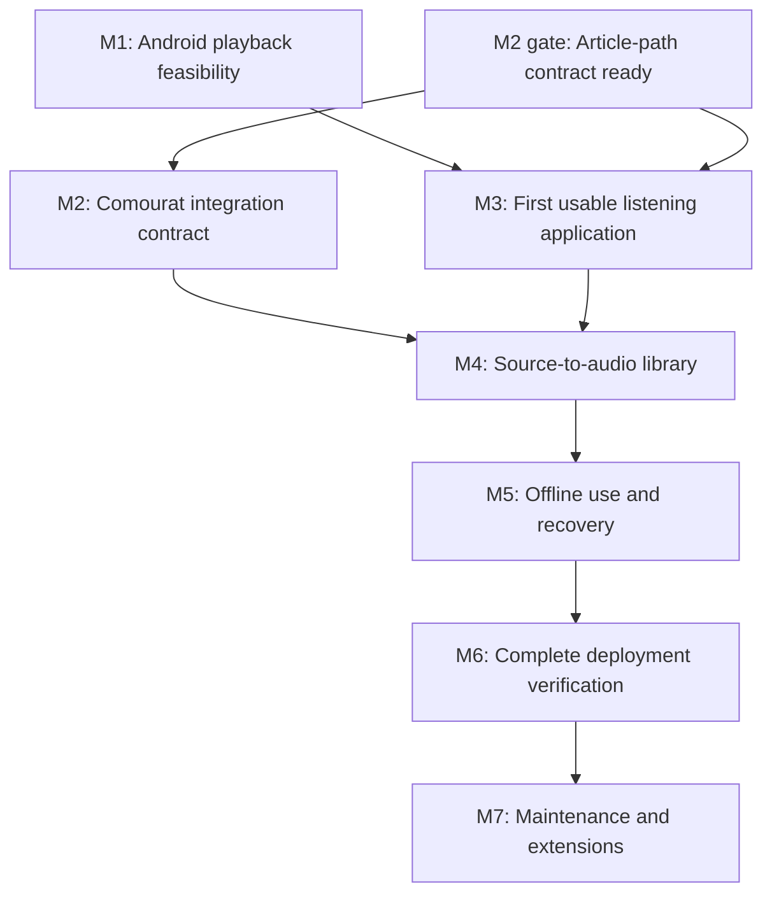

## Vesna constitution spec

### 1. Executive summary

#### 1.1. Project description

Vesna is a mobile-first progressive web application for reading and listening to English Markdown documents, blog posts, web-enriched Reddit post summaries, and arXiv abstracts. Users upload a Markdown file or provide a post URL, a Reddit post URL, or an arXiv URL or identifier. Vesna uses comourat for URL-based content collection, extraction, enrichment, and summarization. A TTS service on the home server generates audio, and the application highlights the paragraph that corresponds to the current playback position. The application supports Chrome on the user's Huawei Pura 80 Pro, playback with the screen locked, access away from home, and offline playback of downloaded text and audio.

#### 1.2. Project motivation

Vesna lets the user listen to selected online or uploaded content without keeping the screen on and follow the text when the screen is visible. It combines content preparation and speech playback in one application, while reusing comourat for URL-based sources instead of maintaining separate collection and extraction code.

#### 1.3. Implementation repos

- `anton-pershin/vesna`: SDD management repository and initial implementation repository for the PWA, application backend, and locally hosted TTS service.

External dependency: `anton-pershin/comourat`. Comourat owns URL-based source collection, content extraction, enrichment, and summarization capabilities. Missing capabilities must be requested through issues in its repository. Vesna must wait for their implementation rather than implement substitutes.

#### 1.4. Architecture type

Layered architecture. The application separates presentation and playback, application operations, and persistence. The application backend, comourat preparation worker, and persistent library storage run on a separate host that provides HTTPS access. The TTS service runs on the home server. The backend calls the TTS service through a protected private connection; HTTP is permitted inside an encrypted tunnel or private VPN. The phone accesses text and audio only through the HTTPS host. The initial implementation remains in one repository; a later approved spec may move the TTS service to a separate repository.

#### 1.5. Execution mode

Manual. Specs are reviewed and approved section by section. Implementation requires explicit user approval and uses automated tests plus real-device checks for Android playback and offline behavior. No separate validation subproject is planned initially.

### 2. Requirement analysis

#### 2.1. Functional requirements

**FR1. Content input**

Accept a UTF-8 Markdown file with a `.md` or `.markdown` extension within a documented size limit, a blog or article URL, a Reddit post URL, or an arXiv abstract/PDF URL or identifier. Show invalid-input, unsupported-file, and unavailable-content errors without creating a playable item. PDF and DOCX file uploads are outside the initial scope; arXiv PDF URLs remain supported.

**FR2. Content preparation through comourat**

Use comourat for all URL-based source collection, extraction, web enrichment, and summarization. Vesna may configure and call these capabilities, store their results, and prepare text for speech. It must not implement alternative source clients, scrapers, extractors, enrichment agents, or summarizers. A Markdown upload requires no external collection; Vesna may read and store the uploaded file directly. If a required comourat capability is missing, create an issue in `anton-pershin/comourat` and wait for its implementation.

**FR3. Source-specific listening text**

- Markdown upload: use the text content of the uploaded document, without summarization by default. Preserve the original file and do not retrieve linked resources automatically.
- Blog/article: use the extracted article text, without summarization by default.
- Reddit: collect the post, add web-derived context, and summarize the combined content for listening. Comments are outside the initial scope.
- arXiv: use the title and abstract. Paper-body extraction and playback are outside the initial scope.

**FR4. Content identity and transparency**

Show each item's title, source URL or uploaded filename, and listening text. Clearly label generated Reddit summaries. Preserve the collected post, enrichment result, or original Markdown file so the user can inspect the source and any generated result. Failure to obtain additional context must not be presented as successful enrichment.

**FR5. Home-server speech generation**

Generate English speech through a TTS service hosted on the home server. Keep TTS credentials and model access on the home server. The preparation worker on the HTTPS host requests speech through a protected private connection and stores the returned audio on the HTTPS host. The TTS endpoint must not be publicly accessible or contacted directly by the phone. Generation must not depend on the phone remaining connected or keeping the app open. Show preparation, ready, and failure states, and allow failed operations to be retried.

**FR6. Playback controls**

Provide play/pause, playback-speed adjustment, previous/next paragraph, and playback starting from a selected paragraph. Save playback position and speed so the user can resume an item after reopening the app.

**FR7. Read-along playback**

Highlight the paragraph that corresponds to the current audio position. Keep the highlight correct after seeking, changing speed, or returning from background playback. Automatically follow the current paragraph, with an option to stop automatic scrolling.

**FR8. Background playback**

Continue an item's playback when the screen is locked or another app is in the foreground, including across paragraph boundaries. Provide lock-screen and headset play/pause controls where Chrome and the device expose them. Do not require the screen to stay on.

**FR9. Offline downloads**

Let the user explicitly download a prepared item, including its listening text, complete audio, and paragraph timing data. Mark it as available offline only after all required data is stored successfully. Downloaded items must support playback, seeking, speed changes, paragraph highlighting, and resume without a network connection.

**FR10. Personal library and storage controls**

List saved items with preparation and download status. Let the user remove a device download without deleting the server copy, or delete the saved item and its associated server data. Report incomplete downloads and detected loss of offline data.

**FR11. Installation and remote access**

Provide an installable PWA for Chrome on the Huawei Pura 80 Pro. Support access away from home through an authenticated HTTPS connection to the separate web/API host. This host serves the PWA, application API, prepared text, timing data, and audio; the home server does not need to provide HTTPS. New content preparation requires connectivity; downloaded playback does not.

#### 2.2. Non-functional requirements

**NFR1. Device verification**

Verify installation, read-along playback, offline playback, and locked-screen playback on the user's actual phone. Record its operating-system and Chrome versions during testing. Desktop browser tests alone are not sufficient.

**NFR2. Playback continuity**

A fully downloaded item must play to completion with the screen locked and the network disabled, without an application-caused stop at a paragraph boundary. Incoming calls, explicit user actions, browser termination, and operating-system termination are outside this continuity guarantee. Their recovery behavior must be tested and documented.

**NFR3. Text/audio consistency**

Audio, listening text, and paragraph timing data must identify the same prepared version. A content or voice change must not silently combine new text with old audio or timing data. Preserve a downloaded version until its replacement is complete.

**NFR4. Offline storage reliability**

Request persistent browser storage where supported. Handle storage denial, insufficient space, and incomplete downloads without falsely reporting offline readiness. Browser data clearing, uninstallation, and operating-system storage removal cannot be prevented; document these limits.

**NFR5. Security**

Require authentication for remote access to private content, uploads, and generation operations. Protect credentials on their respective servers. Protect the web/API-to-TTS connection with an encrypted tunnel or private VPN and restrict the TTS endpoint to authorized server access. Treat submitted URLs, uploaded files, and retrieved content as untrusted input: prevent access to private server-network resources through collection requests, and prevent uploaded or retrieved content from executing scripts in the app.

**NFR6. Recovery**

A failed upload, collection, enrichment, summarization, TTS, or download operation must produce a clear status and must not damage already prepared items. Retrying must not create duplicate library entries or silently repeat completed paid operations. If a provider request may have completed but its outcome cannot be established, record an "outcome unknown" state and require user confirmation before a potentially chargeable retry.

**NFR7. Mobile usability and accessibility**

The main reading and playback screens must fit the phone viewport without horizontal scrolling. Provide labelled controls, visible focus states, sufficient contrast, and a current-paragraph indication that does not depend only on color.

**NFR8. Reproducible verification**

Use automated tests for application behavior and integration contracts, plus documented real-device procedures for browser and operating-system behavior. Verify comourat integrations against the supported version; mocked tests alone do not establish source compatibility.

#### 2.3. Preferences

**P1.** Prefer a small, single-user deployment with explicit configuration and few operational dependencies.

**P2.** Prefer a natural, clear English voice. Select the TTS engine after comparing real samples and measuring generation speed on the home server.

**P3.** Prefer reuse of generated audio and prepared content to reduce repeated computation and API costs.

**P4.** Prefer a focused reading interface with playback controls easy to reach on a phone.

### 3. Acceptance criteria

Acceptance requires automated tests, live integration checks, and real-device tests. Record the tested Vesna commit, comourat version, server configuration, phone operating-system version, and Chrome version. A blocked or unperformed check does not count as a pass. Preferences P1–P4 are not acceptance gates.

**AC1. Input and content preparation**

Covers FR1–FR3 and NFR8.

- Automated tests cover supported input forms, invalid UTF-8, unsupported or oversized document uploads, malformed inputs, unavailable content, and source-specific preparation.
- Live checks prepare at least one public blog/article, one Reddit post, one arXiv abstract, and one uploaded Markdown document. URL-based checks use the supported comourat version.
- The Markdown item uses the uploaded document's text without summarization; the article uses extracted text; the Reddit item uses a summary of the collected post and enrichment result; the arXiv item uses its title and abstract.
- Automated tests verify that Markdown links, images, and other linked resources are not fetched automatically.
- Code review confirms that URL-based source access, extraction, enrichment, and summarization use comourat. Missing upstream capabilities remain explicit blockers.

**AC2. Content transparency**

Covers FR4.

- Each prepared item displays its title, source URL or uploaded filename, and listening text.
- Reddit summaries are labelled as generated, and the collected post and enrichment result can be inspected. The original Markdown file can be inspected for an uploaded item.
- Tests distinguish enrichment with additional context, a successful result with no new context, and an enrichment failure.

**AC3. Server-side speech preparation**

Covers FR5 and NFR6.

- A real preparation run requests paragraph speech from the home-server TTS service through the protected private connection. The HTTPS host assembles and stores playable English audio and paragraph timing data.
- Once the server has accepted a preparation request, disconnecting the phone does not cancel preparation. Reconnecting shows its result.
- Automated tests cover preparation states, failures, and retries.
- Retrying preserves completed stages, avoids duplicate library entries, and does not silently repeat completed paid operations.
- Simulate a lost response after a potentially completed paid request. Verify that the job reports "outcome unknown" and requires user confirmation before a potentially chargeable retry.

**AC4. Playback and read-along**

Covers FR6–FR7 and NFR3.

- On the phone, verify play/pause, speed adjustment, previous/next paragraph, and playback from a selected paragraph.
- Reopening the app restores the saved position and speed.
- The current-paragraph highlight follows playback, seeking, speed changes, and return from background playback. Its visible update occurs within one second of a paragraph transition while the app is in the foreground.
- Automatic scrolling can be disabled without disabling highlighting.
- Automated tests reject mismatched text, audio, and timing versions. An interrupted replacement leaves the previous downloaded version usable.

**AC5. Locked-screen and background playback**

Covers FR8, NFR1, and NFR2.

- On the Huawei Pura 80 Pro, play a fully downloaded item lasting at least 30 minutes and containing multiple paragraph boundaries, with the screen locked and the network disabled. Playback reaches the end without an application-caused stop.
- Separately verify continued playback while another app is in the foreground.
- Verify lock-screen and headset play/pause controls when exposed by the device and Chrome. Record unavailable controls explicitly.
- Test incoming-call interruption, browser termination, and app reopening. Document recovery behavior; do not claim that playback survives process termination.

**AC6. Offline readiness and storage**

Covers FR9–FR10 and NFR4.

- After a complete download, close the app, disable all network connections, and reopen the installed PWA. Its library, downloaded text, audio, and playback controls remain usable.
- Verify offline seeking, speed changes, highlighting, and saved-position recovery.
- Interrupted downloads, insufficient space, denied persistent-storage requests, and missing cached data do not produce a false "available offline" state.
- Removing a device download preserves the server copy. Deleting a saved item removes its associated server data and the local copy on the requesting device.
- Storage limitations are documented.

**AC7. Installation and secure remote access**

Covers FR11 and NFR5.

- Install and launch the PWA through Chrome on the target phone.
- From outside the home network, authenticate over HTTPS, submit a URL, upload a Markdown file, and retrieve prepared text and audio.
- Unauthenticated requests cannot access private server data or start generation.
- Verify that the TTS endpoint is not publicly accessible, that its connection uses an encrypted tunnel or private VPN, and that the phone requests all application content and audio through HTTPS without contacting the TTS endpoint.
- Automated security tests cover private-network and loopback URL targets, redirects to prohibited targets, script-bearing source content, and script-bearing Markdown uploads.
- Review collection and enrichment fetch paths for the same network-access restrictions. Browser-delivered assets and responses contain no server credentials.

**AC8. Failure recovery and mobile accessibility**

Covers NFR6–NFR7.

- Inject failures in upload, collection, enrichment, summarization, TTS, and download operations. Each failure produces a clear status without damaging existing prepared items.
- Verify that the main screens have no horizontal overflow on the target phone.
- Automated checks and manual inspection verify labelled controls, visible focus, readable contrast, and a current-paragraph indication that does not rely only on color.

**AC9. Verification evidence**

Covers NFR1 and NFR8.

- Store automated test results, live integration results, and real-device test records in the repository.
- Include reproduction steps and explicit pass, fail, or blocked outcomes.
- Accept the implementation only when every acceptance criterion passes.

### 4. Insight

#### 4.1. Browser-driven speech and paragraph playback

The browser requests speech for each paragraph and starts the next audio segment when the current segment ends. The application highlights the paragraph associated with that segment.

This approach allows playback to start before the complete item is generated. However, transitions depend on browser code running while the application is in the background. It also requires careful handling of missing segments, network failures, and offline downloads. These dependencies make it a poor fit for the locked-screen and offline requirements.

#### 4.2. Server-prepared audio with paragraph timing data

For URL-based sources, the HTTPS host uses comourat to prepare the listening text. For Markdown uploads, it uses the stored document's text. It divides the listening text into paragraphs and requests speech from the home-server TTS service. It produces one complete audio file per prepared item and timing data that maps each paragraph to its position in that file.

The browser plays the audio through a standard HTML media element. The reading interface uses the media playback position to select the highlighted paragraph. Paragraph navigation seeks within the same audio file; it does not replace the audio source. A download stores the complete audio, matching text, and timing data before the item becomes available offline.

This approach moves content preparation and audio assembly to the HTTPS host and speech generation to the home server and avoids application-controlled audio transitions at paragraph boundaries. Its main costs are preparation time and storage for generated audio.

#### 4.3. Selected approach

Use server-prepared audio with paragraph timing data.

Initially, generate speech paragraph by paragraph on the home server, then assemble the returned results into one audio file on the HTTPS host. Derive paragraph timings from the generated audio and verify them against the final encoded file. This avoids requiring word-level alignment while supporting paragraph highlighting and navigation.

Use the browser's media playback position as the timing reference. Do not use a separate JavaScript timer as the playback clock. Use the Media Session API for supported lock-screen and headset controls.

Store preparation progress and completed outputs on the HTTPS host so work does not depend on the phone connection. Preserve completed stages for retries. Publish a prepared version only when its text, audio, and timing data are complete and consistent.

Use comourat for URL-based content preparation, with Vesna supplying configuration and application-specific prompts. Read Markdown uploads directly from stored files. Keep the TTS interface separate from the content-preparation interface so a later repository split does not require changes to source collection or direct Markdown input.

Verify the selected playback approach on the actual phone before building the complete content workflow. Standard media playback reduces dependence on background JavaScript, but does not establish that Chrome and the phone will satisfy the locked-screen requirement.

### 5. Overall solution design

#### 5.1. High-level design

Use a layered architecture deployed across the phone, a separate HTTPS host, and the home server. All initial Vesna components remain in `anton-pershin/vesna`. Comourat is an external library dependency installed on the HTTPS host.

The diagram shows layers and deployment locations. The comourat library runs on the HTTPS host; its external-dependency group identifies ownership, not a separate deployment.

**Presentation layer — phone**

The PWA provides content input, library management, reading, playback, and download controls.

An HTML audio element plays a complete audio file per item. Paragraph highlighting follows its playback position. Media Session connects supported system controls to this player.

A service worker supports offline launch and serves downloaded audio, including byte-range requests for seeking. Device storage holds downloaded text, audio, timing data, metadata, and playback state.

**Application layer — HTTPS host**

An authenticated API accepts preparation requests, returns job status, manages library items, and serves prepared text and audio over HTTPS.

A preparation worker executes durably stored jobs independently of the browser connection. It calls comourat for URL-based content preparation or reads a stored Markdown upload. It establishes the listening paragraphs, requests speech from the home server, and assembles the returned audio and paragraph timing data.

Completed preparation stages are saved for retries. A version becomes ready only after its text, audio, and timing data are complete and consistent.

**Application layer — home server**

A private TTS service accepts paragraph text and configured voice settings and returns generated audio. It does not collect content or manage the library.

The HTTPS host reaches this service through an encrypted tunnel or private VPN. HTTP is permitted inside that connection. The TTS endpoint is not publicly accessible, and the browser never contacts it directly.

**Persistence layer**

The HTTPS host stores library records, job progress, collected content, original Markdown uploads, enrichment results, summaries, and version metadata. Its artifact store holds generated segments, complete audio files, and timing data.

Device persistence is independent of server persistence. Downloaded playback and offline launch do not require either server or a refreshed authentication session.

**Security and updates**

Authentication protects server operations and artifacts. Collection and enrichment requests must not reach private network resources, including the TTS endpoint. Enforce these restrictions through deployment controls or supported comourat interfaces; missing library capabilities follow the upstream issue process.

Service-worker updates must preserve active playback and usable downloads. Credentials, authentication responses, and generation endpoints must not enter the offline cache.

#### 5.2. Core components

- Presentation layer:
  - PWA interface and audio player.
  - Service worker.
  - Device-storage access component.
- Application layer:
  - Authenticated API on the HTTPS host.
  - Preparation worker and comourat integration on the HTTPS host.
  - Audio assembly and paragraph-timing component on the HTTPS host.
  - Private TTS service on the home server.
- Persistence layer:
  - Server records and job storage on the HTTPS host.
  - Artifact storage on the HTTPS host.
  - Browser storage on the phone.

### 6. Roadmap

Durations are planning estimates in weeks for one full-time person. They exclude time waiting for upstream comourat changes, access to the HTTPS host, and user-assisted phone tests. Each milestone will use separately approved implementation specs.

| ID | Name | Status | Expected result | Duration | Strong scaling efficiency |
|----|------|--------|-----------------|----------|---------------------------|
| M1 | Verify Android playback feasibility | Done | An installed PWA plays a downloaded, multi-paragraph audio item for at least 30 minutes with the screen locked and the network disabled. Read-along, seeking, and resume work on the target phone. Record operating-system and Chrome versions. | 2–4 weeks | Low; the work depends on sequential device tests. |
| M2 | Establish the comourat integration contract | Done | Verify public interfaces for article extraction, Reddit URL collection, enrichment and summarization, and arXiv abstract retrieval. Prioritize the article path required for the first usable application. Verify URL-access restrictions and redirect handling in live integration checks. Create issues for missing capabilities. Close this milestone only when the required capabilities and live security checks pass. | 2–4 weeks, excluding upstream waiting time | Moderate; source-specific checks can run independently. |
| M3 | Deliver the first usable listening application | To do | A user can authenticate, submit a public article URL or upload a Markdown file, and save and play the prepared result. The HTTPS host requests real English speech from the private home-server TTS service, assembles complete audio and paragraph timing data, and continues preparation after the phone disconnects. Select the voice using real samples and measured generation speed. Provide a reproducible HTTPS deployment and verify the protected server-to-server connection. | 3–6 weeks | Moderate; TTS evaluation and HTTPS deployment can proceed independently. |
| M4 | Deliver the source-to-audio library | To do | Add Reddit and arXiv items, complete library and source-transparency features, and support safe retries, including "outcome unknown". Jobs retain completed stages, and users can inspect preparation status and source content for every supported input type. | 3–6 weeks | Moderate; interface and backend work can proceed against agreed contracts. |
| M5 | Complete offline use and recovery | To do | Downloads, storage controls, version replacement, offline launch, playback-state recovery, and service-worker updates satisfy their acceptance criteria. Failure tests cover partial downloads, storage loss, and preparation failures. | 3–6 weeks | Low to moderate; browser storage and playback behavior require integrated tests. |
| M6 | Verify the complete deployment | To do | All constitution acceptance criteria pass, with reproducible evidence from automated tests, live integrations, and the target phone. Remote access works outside the home network. Deployment, recovery, and operating instructions are documented. | 2–4 weeks | Low; final verification depends on the integrated system. |
| M7 | Maintain compatibility and extend components as needed | To do | Preserve verified behavior as Chrome, the phone software, comourat, and TTS dependencies change. Extend component repositories as needed through approved specs. Review deployment and storage recovery over the project's operating life. | Ongoing; five-year maintenance horizon | Depends on the approved change. |

M1 may use a prepared audio, text, and paragraph-timing fixture. This verifies playback only and does not satisfy the real TTS or comourat integration criteria.

M2 can run in parallel with M1. M3 starts when the article-path contract is ready; the remaining M2 source checks may run in parallel with M3. Upstream collection blockers do not prevent the playback feasibility test.

M3 establishes basic authentication and reproducible deployment. M4 preserves the offline publication and version-integrity contracts established by M1. M6 verifies these security and deployment foundations rather than introducing them.

The initial delivery estimate is 15–30 person-weeks, not a calendar commitment. The first decision gate is M1: if the phone cannot meet the core PWA playback requirement, stop and review the approach before building the full application.
