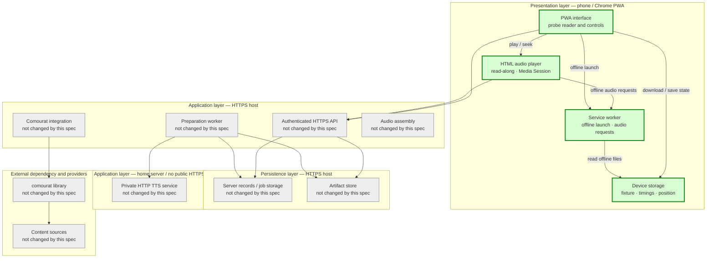
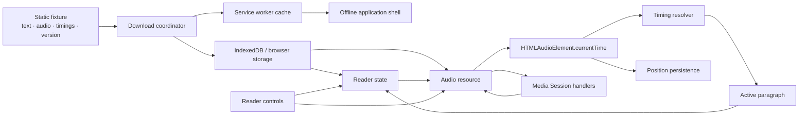

## Android playback feasibility general spec

### 1. Executive summary

#### 1.1. Spec description

This spec defines a small installable PWA probe for the Huawei Pura 80 Pro. The probe uses a prepared local fixture containing English text, one complete audio file, and paragraph timing data. It verifies offline launch, audio playback, read-along highlighting, seeking, resume, playback speed, screen-locked playback, and playback while another application is in the foreground. It does not implement comourat integration, the TTS service, user authentication, remote content preparation, or the Vesna library.

The probe is a feasibility gate for the full Vesna project. It must produce a clear evidence record on the target phone. A failure in a browser or device capability must be reported before the full content workflow is designed.

#### 1.2. Spec motivation

Locked-screen playback and reliable playback across paragraph boundaries are the highest-risk Vesna requirements. Testing these requirements first avoids building content collection, TTS, and storage features on top of an unsuitable browser playback model.

A static fixture makes the test independent of comourat, external providers, and the home-server TTS connection. This isolates browser and device behavior while keeping the probe small.

#### 1.3. Implementation repos

- `anton-pershin/vesna`: management repository and the only implementation repository for this spec. It will contain the probe, fixture files, automated tests, and the device-test evidence template.
- `anton-pershin/comourat`: external dependency of the Vesna constitution, but out of scope for this spec. No comourat changes are needed for this playback probe.

#### 1.4. Architecture type

Layered architecture. The probe has a presentation layer with the reader and controls, an application layer with playback and timing logic, and a persistence layer with the service worker and browser storage.

### 2. Requirement analysis

#### 2.1. Functional requirements

**FR1. Installable probe**

Provide a valid web app manifest and service worker so Chrome can install the probe as a PWA from an HTTPS origin. The probe must show its application name and icon in the install flow.

**FR2. Offline fixture**

Include a deterministic English fixture with at least 30 minutes of audio, at least 12 paragraphs, paragraph identifiers, and timing data for the complete audio file. The fixture must be distributed with the probe and must not require a network request after installation and download.

**FR3. Offline launch**

Cache the application shell, fixture metadata, fixture text, timing data, and audio. After a successful download, launch the installed probe with the network disabled and show the fixture library entry and reader.

**FR4. Playback controls**

Provide play, pause, seek, playback-speed selection, previous-paragraph, next-paragraph, and play-from-selected-paragraph controls. Use one complete HTML audio resource for the fixture instead of replacing the audio resource at paragraph boundaries.

**FR5. Read-along highlighting**

Use the audio element's `currentTime` as the playback clock. Highlight the paragraph whose timing interval contains the current position. Update the highlight after normal playback, seeking, changing speed, pausing, resuming, and returning from the background.

**FR6. Read-along scrolling**

Scroll the active paragraph into view during playback when automatic scrolling is enabled. Provide a control that disables automatic scrolling without disabling the active-paragraph highlight.

**FR7. Playback state**

Save the current position, playback speed, and selected fixture version in browser storage. Restore them after closing and reopening the installed probe while the fixture remains available offline.

**FR8. Media controls**

Register Media Session metadata and supported play, pause, seek-backward, seek-forward, and track-position actions. Use the same audio player for page controls and supported lock-screen or headset controls.

**FR9. Device-test evidence**

Provide a device-test record with fields for the phone model, Android version, Chrome version, tested commit, origin, network state, test steps, and observed result. Record pass, fail, or blocked for every acceptance criterion.

#### 2.2. Non-functional requirements

**NFR1. Target device**

The primary device is the user's Huawei Pura 80 Pro using Chrome. Desktop browser checks support development but cannot pass the device acceptance criteria.

**NFR2. Locked-screen continuity**

A fully downloaded fixture must play to completion for at least 30 minutes while the phone screen is locked and all network connections are disabled. The application must not stop at a paragraph boundary.

**NFR3. Background continuity**

The fully downloaded fixture must continue playing while another application is in the foreground, subject to operating-system interruption and explicit user actions.

**NFR4. Highlight timing**

When the reader is visible, the active paragraph must change within one second after a timing boundary is crossed. The test must use the final audio file's duration and the supplied timing data.

**NFR5. Offline integrity**

The probe must not report offline readiness until all required shell, metadata, text, timing, and audio resources are stored successfully. A failed or partial download must be recoverable without corrupting a previous complete fixture.

**NFR6. Browser safety**

The probe must not require credentials, external API keys, remote content, or a server-side runtime. The fixture text must be rendered as text and must not execute markup or scripts from the fixture data.

**NFR7. Test reproducibility**

Automated tests must run without the target phone. Device tests must state which checks require manual observation and must preserve raw observations rather than only a final summary.

### 3. Acceptance criteria

**AC1. Probe structure and installation**

Covers FR1 and NFR1.

- Automated tests verify the manifest, service-worker registration, required application-shell resources, and fixture metadata.
- From an HTTPS origin, Chrome can install the probe as a PWA and launch it.
- The device-test record contains the actual phone model, Android version, Chrome version, tested commit, and origin.

**AC2. Offline launch and readiness**

Covers FR2–FR3 and NFR5.

- Complete the probe's download action.
- Disable Wi-Fi and mobile data.
- Close the PWA and launch it again from the installed-app entry.
- The fixture title, text, paragraph list, controls, and audio player are available without a network request.
- Automated tests cover successful, interrupted, and incomplete downloads. No incomplete download is marked offline-ready.

**AC3. Foreground playback and read-along**

Covers FR4–FR6 and NFR4.

- With the network disabled, play the fixture in the foreground.
- Verify play, pause, seek, speed selection, previous paragraph, next paragraph, and play-from-selected-paragraph.
- Verify that the active paragraph follows the final audio position and that the highlight changes within one second of each tested paragraph boundary.
- Verify automatic scrolling and the option to disable automatic scrolling.

**AC4. State restoration**

Covers FR7.

- Stop at a non-zero position and select a non-default playback speed.
- Close and reopen the installed PWA while offline.
- Verify restoration of the selected fixture version, playback position, and speed.
- Verify that storage loss or an unknown fixture version is reported instead of producing silent incorrect state.

**AC5. Locked-screen playback**

Covers FR8 and NFR1–NFR2.

- Start the fully downloaded fixture on the Huawei Pura 80 Pro.
- Lock the screen and keep Wi-Fi and mobile data disabled.
- Verify playback for at least 30 minutes and across at least 12 paragraph boundaries.
- Verify that playback reaches the end without an application-caused stop at a paragraph boundary.
- Record lock-screen controls exposed by Chrome and the device. A control not exposed by the platform is recorded as unavailable, not treated as an implementation failure.

**AC6. Other-application playback**

Covers NFR3.

- Start the fully downloaded fixture.
- Open another application and leave Vesna in the background.
- Verify continued playback across paragraph boundaries.
- Test lock-screen pause and resume, headset play and pause if available, and return to the PWA.
- Record interruptions caused by calls, operating-system policy, or explicit user actions separately from application-caused failures.

**AC7. Version and resource integrity**

Covers NFR5–NFR6.

- Automated tests verify that text, audio, and timing data use one fixture-version identifier.
- A simulated incomplete replacement leaves the previous complete fixture usable.
- The probe never combines timing data from one fixture version with audio or text from another version.

**AC8. Evidence and decision**

Covers FR9 and NFR7.

- Store the completed device-test record and automated test output under `evidence/android-playback/`.
- Mark every criterion pass, fail, or blocked, with reproduction steps and raw observations.
- The feasibility result is `pass` only if AC1–AC7 pass on the target phone. A platform limitation or blocked device test prevents a pass.
- A pass authorizes the next Vesna implementation spec to use one complete audio file with paragraph timing data and Media Session controls. A fail requires an architecture review before full application implementation.

### 4. Insight

#### 4.1. Browser-driven paragraph audio

The browser could request one audio segment for each paragraph and start the next segment when the current segment ends. This gives early playback and can use a small amount of audio storage. It depends on JavaScript running during background playback and makes offline transitions sensitive to browser scheduling, resource loading, and device power policy. It is not selected for this probe.

#### 4.2. One complete audio file with timing data

The probe can play one complete audio file and map its playback position to paragraph timing intervals. Browser media playback can continue without application-controlled resource transitions at paragraph boundaries. The complete file is simple to download and seek, but it needs more storage and a reliable timing map. This matches the selected Vesna design and is selected.

#### 4.3. Selected approach

Implement the smallest possible static PWA using one complete local audio file, deterministic paragraph timing data, an HTML audio element, browser storage, a service worker, and Media Session. Keep the fixture and playback logic independent of comourat and TTS. Use the result to decide whether the full Vesna architecture can proceed.

### 5. Overall solution design

#### 5.1. High-level design

The following diagram copies the constitution's layered design and marks the components created or modified by this spec in green. Components outside the probe remain unchanged and are shown in gray.

The component design is:

The probe uses a local fixture in development and stores a verified copy for offline use. The timing resolver is a pure component: it receives a playback position and ordered timing intervals and returns one paragraph identifier or no active paragraph. The audio player remains the single playback clock.

#### 5.2. Core components

- PWA shell and manifest: provide the installable application entry, icon, and static reader page.
- Service worker: cache the shell and serve fixture resources while offline. It does not own playback state.
- Download coordinator: download and verify all fixture resources, then publish one offline-ready version atomically.
- Browser storage adapter: store fixture metadata, text, timing data, downloaded-resource state, playback position, speed, and version identifiers.
- Audio player: wrap one HTML audio element and expose play, pause, seek, speed, paragraph navigation, and completion behavior.
- Timing resolver: map `currentTime` to a paragraph identifier and support boundary and seek updates.
- Read-along reader: render fixture paragraphs, highlight the active paragraph, and optionally scroll it into view.
- Media Session adapter: register metadata and supported actions and delegate them to the audio player.
- Device-test evidence: store the test procedure and the completed result without claiming that desktop tests replace phone tests.

### 6. Implementation plan

#### 6.1. Todo list

1. Create the shared implementation branch from `origin/main` and preserve this spec on the branch.
2. Select a browser-only implementation stack that does not require a package installation for the first probe unless the existing project configuration is extended explicitly.
3. Create the PWA manifest, application shell, reader page, and accessible control layout.
4. Create a deterministic fixture manifest with one version identifier, at least 12 paragraphs, paragraph text, and timing intervals covering at least 30 minutes of audio.
5. Add or generate the fixture audio and verify its duration and decodability with a local media tool. Do not commit credentials or proprietary source material.
6. Implement the pure timing resolver and tests for normal playback, exact boundaries, seeks before and after intervals, end-of-file behavior, and malformed timing data.
7. Implement the audio-player state machine around one HTML audio element. Test play, pause, seek, speed, paragraph navigation, completion, and stale-version rejection.
8. Implement browser-storage persistence for fixture versions, playback position, speed, and offline readiness. Test interrupted and incomplete download states.
9. Implement the service worker and offline resource loading. Test a fresh install, completed download, network-disabled launch, and missing-resource failure.
10. Implement Media Session metadata and action handlers. Test registration and delegation in a browser-capable environment; leave device-only controls for manual testing.
11. Implement read-along highlighting, optional auto-scroll, and accessible non-color active-state styling. Test updates after time progression, seek, pause, resume, speed changes, and restored state.
12. Run automated tests and static checks on the implementation host.
13. Deploy the probe to an HTTPS origin reachable by the phone. Use a static host that returns single-range `206` responses for audio. Record the exact URL and commit in the evidence file.
14. Run the complete target-phone procedure with Wi-Fi and mobile data disabled during offline and locked-screen tests.
15. Store automated output and raw device observations under `evidence/android-playback/`.
16. Decide the feasibility result from AC1–AC7. If the result is not pass, stop and revise the architecture before implementing the full Vesna content workflow.

#### 6.2. Modification summary

| File | Action |
|------|--------|
| `.internal/specs/01-android-playback-feasibility-general-spec.md` | New: this implementation contract. |
| `package.json` | New: only if a JavaScript test or build runner is selected. Keep dependencies minimal. |
| `public/modules/` | New: canonical browser modules for playback, timing, storage, offline readiness, and Media Session. Tests import these served files directly. |
| `public/manifest.webmanifest` | New: install metadata and icons. |
| `public/fixtures/` | New: fixture manifest, text, paragraph timing data, and audio resource. |
| `scripts/static_server.py` | New: dependency-free static server with single-range audio responses and optional TLS. |
| `tests/` | New: unit and browser-level tests for timing, playback state, storage, offline readiness, HTTP ranges, and version integrity. |
| `evidence/android-playback/README.md` | New: device-test procedure and evidence format. |
| `evidence/android-playback/result.md` | New: completed target-phone result, created during verification. |
| `README.md` | New or modified: local development, HTTPS deployment, installation, offline test, and evidence instructions. |
