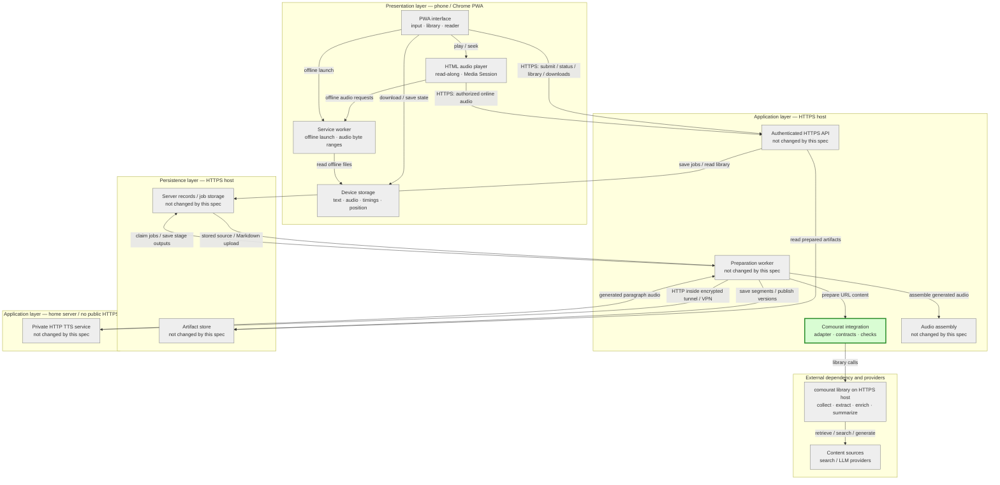
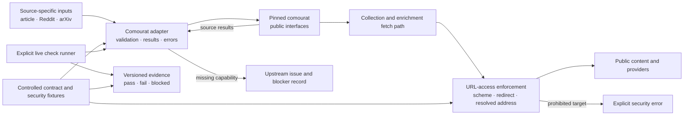

## Comourat integration general spec

### 1. Executive summary

#### 1.1 Spec description 

This spec establishes a verified contract between Vesna and a supported comourat version for public blog/article extraction, Reddit collection and summarization, and arXiv abstract retrieval. It prioritizes the article path required by M3 and verifies URL-access restrictions for direct requests and redirects. It produces a reusable integration boundary, automated contract checks, live evidence, and explicit upstream issues for missing capabilities. It does not implement TTS, the personal library, durable preparation jobs, or the Markdown upload workflow.

#### 1.2 Spec motivation

M3 needs a known article-extraction interface before it can deliver the first usable application, and M4 depends on the remaining source capabilities. Early verification prevents Vesna from duplicating comourat behavior or building on unverified interfaces. URL-access checks are required now because the backend will request untrusted URLs from a machine with private-network access.

#### 1.3 Implementation repos

- `anton-pershin/vesna`: management repository and implementation repository for the integration boundary, automated checks, and live evidence.
- `anton-pershin/comourat`: external dependency whose public interfaces and live behavior are verified. This spec does not change comourat. Missing capabilities are requested through issues and remain explicit blockers.

### 2. Requirement analysis

#### 2.1 Functional requirements

**FR1. Article extraction contract**

Define and verify the comourat interface that accepts a public blog or article URL and returns source metadata and extracted article text. Preserve the article's title and source URL. Do not summarize the article by default. Reject invalid URLs, unavailable content, and empty extraction results without reporting successful preparation.

**FR2. Reddit preparation contract**

Define and verify the interfaces that collect a public Reddit post, obtain web-derived enrichment, and summarize the combined content for listening. Preserve the collected post and enrichment result for inspection. Distinguish enrichment with additional context, successful enrichment with no additional context, and enrichment failure. Do not collect comments or present failed enrichment as successful.

**FR3. arXiv preparation contract**

Define and verify the comourat interface that accepts an arXiv abstract/PDF URL or identifier and returns the paper title and abstract. Do not extract or prepare the paper body.

**FR4. Vesna integration boundary**

Put all comourat calls behind one testable adapter with explicit input, result, and error contracts. Vesna must call public comourat interfaces and must not add alternative source clients, scrapers, extractors, enrichment agents, or summarizers. Missing capabilities must produce explicit blocker records and upstream issues.

**FR5. URL-access restrictions**

Allow only supported HTTP and HTTPS collection and enrichment targets. Prevent collection and enrichment requests from reaching loopback, private, link-local, or otherwise prohibited network destinations, including the home-server TTS endpoint. Apply the same policy to every redirect and every resolved destination address. A prohibited target must fail before any request is sent to it.

**FR6. Failure and evidence reporting**

Return clear, source-specific errors for invalid input, timeouts, unavailable content, and failed provider operations. Record the exact Vesna commit, comourat version, Python version, test configuration, public source identifiers, reproduction commands, and raw results for live checks. Missing upstream capabilities must remain visible in the evidence.

#### 2.2 Non-functional requirements

**NFR1. Supported dependency version**

Pin and record one supported comourat version for automated and live checks. Mocked tests must not be treated as proof that this version provides the required behavior.

**NFR2. Reproducible automated checks**

Run contract and security tests without external services, credentials, or target-phone access. Use controlled local fixtures for success, failure, redirect, and prohibited-target cases. Keep live public-source checks in a separate, explicitly invoked command.

**NFR3. Security and secret handling**

Do not expose private-network services during tests. Do not place credentials, authentication responses, private content, or generation endpoints in test logs, live evidence, browser assets, or repository fixtures.

**NFR4. Bounded and transparent operations**

Apply documented connection and overall timeouts to external operations. Preserve the distinction between an empty successful result and a failed operation. An error or timeout must not be converted into successful extraction, enrichment, or summarization.

**NFR5. Minimal and testable design**

Keep the adapter small and independent of the PWA, TTS service, durable jobs, and personal library. Use dependency injection where it enables deterministic tests. Do not add a web framework, database, or production deployment changes in this spec.

### 3. Acceptance criteria

**AC1. Article extraction**

Covers FR1, FR4, FR6, NFR1, NFR2, and NFR4.

- Automated tests cover a valid article, malformed URLs, unsupported schemes, unavailable content, empty extraction, timeouts, and provider errors.
- The result preserves the article title, source URL, and extracted text without summarization.
- A live check with one public blog or article returns a non-empty title and expected article text using the pinned comourat version.

**AC2. Reddit preparation**

Covers FR2, FR4, FR6, NFR1, NFR2, and NFR4.

- Automated tests cover enrichment with additional context, successful enrichment with no additional context, enrichment failure, summarization failure, unavailable content, and timeouts.
- The collected post and enrichment result remain available for inspection. Comments are not requested or included.
- A live check with one public Reddit post returns the collected post, enrichment result, and a generated summary based on their combined content. Failed enrichment is not reported as successful.

**AC3. arXiv preparation**

Covers FR3, FR4, FR6, NFR1, NFR2, and NFR4.

- Automated tests cover abstract URLs, PDF URLs, identifiers, malformed input, unavailable papers, empty results, and provider errors.
- A live check with one public arXiv paper returns its expected title and abstract using the pinned comourat version. No paper-body text is returned.

**AC4. Adapter and error contracts**

Covers FR4, FR6, NFR4, and NFR5.

- Code review confirms that all comourat access uses the adapter's public integration boundary and that Vesna contains no alternative collection, extraction, enrichment, or summarization implementation.
- Tests prove that invalid input and provider failures produce explicit errors rather than successful results.
- Tests enforce the documented connection and overall timeouts without long-running test cases.
- The adapter has no dependency on the PWA, TTS service, durable jobs, database, or personal library.

**AC5. URL-access security**

Covers FR5, NFR2, and NFR3.

- Automated tests accept supported public HTTP and HTTPS targets and reject unsupported schemes, loopback, private, link-local, unspecified, and other prohibited destinations, including IPv4 and IPv6 forms.
- Collection and enrichment paths are tested independently for direct prohibited targets, redirects to prohibited targets, and a destination resolution that changes to a prohibited address.
- Live checks execute the real comourat direct and redirect rejection paths against controlled prohibited listeners. Each listener records zero requests. A public redirect service may be used for the redirect check; an unavailable service blocks the check.
- The home-server TTS endpoint is denied by policy and is not contacted during testing.
- Test logs, live evidence, browser assets, and repository fixtures contain no credentials, private content, authentication responses, or generation endpoints.

**AC6. Evidence and milestone decision**

Covers FR6, NFR1–NFR5, and the M2 roadmap result.

- Automated contract and security tests pass in CI without external services or credentials.
- The explicitly invoked live command produces passing article, Reddit, arXiv, and direct/redirect security checks using the pinned comourat version.
- `evidence/comourat-integration/` contains the Vesna commit, comourat version, Python version, test configuration, source identifiers, reproduction commands, raw results, and explicit pass, fail, or blocked outcomes.
- Every missing comourat capability has an upstream issue with the required behavior and evidence. M2 cannot pass while such a capability remains a blocker or while any live check is unperformed.

### 5. Overall solution design

#### 5.1 High-level design

The following diagram copies the constitution's layered design and marks the component created or modified by this spec in green. The future preparation worker, application API, TTS service, and personal library remain unchanged.

The component design separates source contracts from network-policy enforcement and verification:

Vesna validates inputs and owns the adapter's result and error contracts. Comourat and deployment controls enforce the collection and enrichment fetch policy; Vesna does not add a substitute fetcher. The future preparation worker will call the adapter only in a later spec.

#### 5.2 Core components (optional; ask the user)

- **Comourat adapter:** New source-specific input, result, and error contracts for article, Reddit, and arXiv operations. It exposes public comourat behavior without application-job or UI dependencies.
- **URL-access policy contract:** New scheme, destination-address, redirect, and resolution checks at the collection and enrichment fetch boundaries. Supported comourat controls and deployment egress controls implement this policy; Vesna does not create an alternative collection client.
- **Controlled test harness:** New local fixtures for source results, failures, redirects, prohibited destinations, and resolution changes. It records whether a prohibited endpoint received a request.
- **Live check runner:** New explicit command for the three public-source checks using the pinned comourat version. It writes raw, reproducible evidence instead of running as an uncontrolled CI dependency.
- **Evidence and upstream blocker records:** New versioned records under `evidence/comourat-integration/` and links to any required comourat issues.

