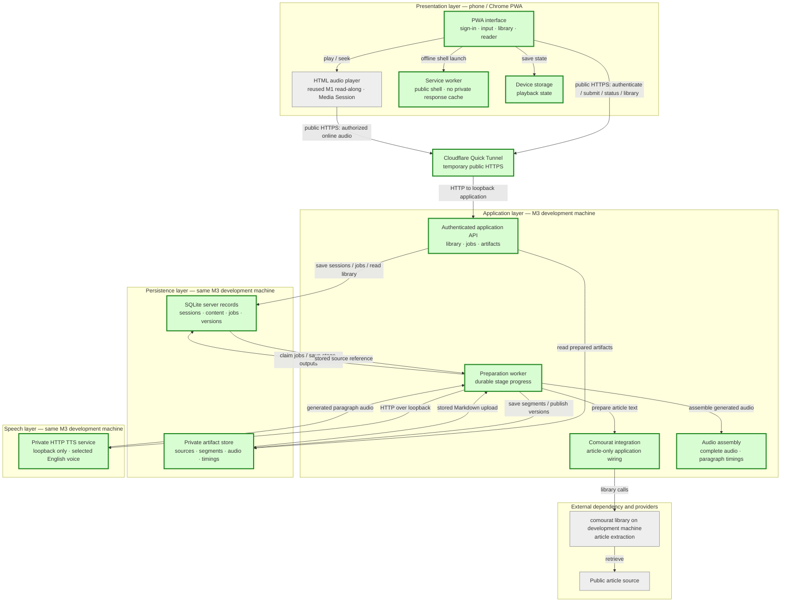
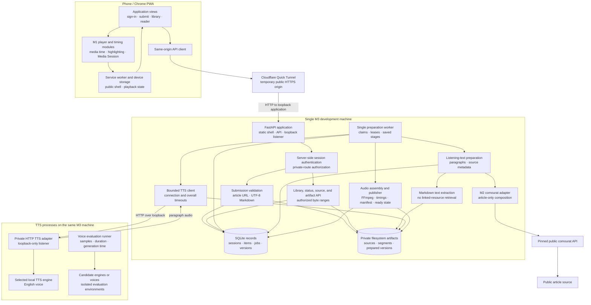

## First usable listening application general spec

### 1. Executive summary

#### 1.1 Spec description 

This spec delivers the first usable Vesna application for public article URLs and UTF-8 `.md` or `.markdown` uploads. An authenticated user can submit content, save prepared items, and play English audio with read-along controls. One development machine runs the M2 adapter, durable jobs, audio assembly, and a loopback-only TTS service. A Cloudflare Quick Tunnel provides reproducible temporary public HTTPS, and real samples and measured speed guide voice selection; Reddit and arXiv inputs, advanced retries, real-item offline recovery, and split-host deployment remain in later milestones.

#### 1.2 Spec motivation

M1 verified target-phone playback, and M2 verified the comourat integration contract, but Vesna does not yet let a user prepare and listen to personal content. M3 connects these verified boundaries into a secure, usable application and establishes the real TTS and deployment base required by later milestones.

#### 1.3 Implementation repos

- `anton-pershin/vesna`: management repository and implementation repository for the PWA, authenticated application API, preparation worker, server records and artifacts, audio assembly, local TTS service, development deployment configuration, and verification evidence.
- `anton-pershin/comourat`: external dependency used through the public M2 adapter for article extraction. This spec plans no comourat code changes. Any missing capability requires an upstream issue and remains an explicit blocker.

### 2. Requirement analysis

#### 2.1 Functional requirements

**FR1. Authenticated application access**

Provide sign-in and sign-out for the configured user. Require authentication for uploads, preparation requests and status, saved items, source content, listening text, paragraph timing data, and audio. Public application assets and the authentication operation may remain public, but unauthenticated users must not read private data or start preparation.

**FR2. Public article input**

Accept a public HTTP or HTTPS blog or article URL. Validate the input and use the pinned M2 comourat adapter for extraction; do not add another collector or extractor. Preserve the article title, source URL, and extracted article text as listening text without summarization by default. Malformed URLs, unsupported or prohibited targets, unavailable content, and empty extraction results must produce an error and must not produce a ready item.

**FR3. Markdown upload**

Accept a direct UTF-8 file upload with a `.md` or `.markdown` extension within a documented size limit. Reject invalid UTF-8, unsupported extensions, and oversized files without producing a ready item. Use the uploaded document's text without summarization, preserve the original file for inspection, and do not retrieve linked resources automatically. Display uploaded content without executing embedded scripts.

**FR4. Saved library and source transparency**

Save each accepted submission as one library item. List saved items with their title, source URL or uploaded filename, and preparation state. Let the user open an item to inspect its listening text and source information; for a Markdown item, also provide the original file. Do not present incomplete or failed output as a prepared item.

**FR5. Durable preparation**

Record accepted content, preparation jobs, and their progress on the development machine. Continue preparation after the phone disconnects, the browser closes, or the PWA loses connectivity. When the user reconnects, show the current state and the prepared result if preparation has completed. Preparation must not depend on browser execution or an active phone connection.

**FR6. Local speech generation**

Divide the listening text into paragraphs and request real English speech for each paragraph from the TTS service on the same development machine as the preparation worker. Send requests only through the loopback interface and store returned audio on that machine. Keep TTS credentials and model access on that machine. The phone must not contact the TTS endpoint directly. The split host/home-server connection remains outside M3.

**FR7. Audio assembly and prepared-version publication**

Assemble generated paragraph audio into one complete audio file and produce matching paragraph timing data for each prepared version. Verify the timing data against the final encoded audio. Publish a prepared version and mark its item ready only when its listening text, complete audio, and paragraph timing data are complete and identify the same version. Never publish partial audio or combine data from different versions.

**FR8. Voice evaluation and selection**

Generate real English speech samples for candidate TTS configurations on the M3 development machine and measure their generation speed there. Record the compared configurations, sample results, measured speeds, selected engine and voice, and effective voice settings. Use the selected configuration for the live M3 preparation check.

**FR9. Online playback and read-along controls**

Play ready items through the public HTTPS application URL with the existing HTML audio playback model. Provide play/pause, playback-speed adjustment, previous/next paragraph, playback from a selected paragraph, current-paragraph highlighting, and optional automatic scrolling. Save and restore playback position and speed. Preserve the verified M1 locked-screen, headset, installation, offline-publication, and version-integrity behavior.

**FR10. Failure states and basic retries**

Show clear preparation, ready, and failure states for upload, article extraction, speech generation, and audio assembly. A failed operation must not damage an existing prepared version. Let the user retry a known failed preparation without creating a duplicate library item or silently discarding usable output. Advanced retry orchestration, including outcome-unknown and potentially chargeable retries, remains outside M3.

**FR11. Reproducible HTTPS development deployment and remote access**

Provide versioned configuration and instructions that reproduce the PWA, authenticated API, preparation worker, server records, artifact storage, and local TTS service on one development machine. Use a Cloudflare Quick Tunnel to support authenticated HTTPS access from outside the home network without a domain or inbound port 443. Expose only the application through this tunnel. Use a loopback-only TTS listener, configure only the local worker to call it, and do not expose it publicly. The phone must obtain all application content and audio through the temporary public application HTTPS URL. Stable production HTTPS and the split host/home-server deployment remain outside M3.

#### 2.2 Non-functional requirements

**NFR1. Security and secret handling**

Use the Cloudflare-provided HTTPS URL for all phone-to-application API and artifact traffic. Keep credentials on the development machine and out of source control, logs, evidence, browser assets, and offline caches. The service worker must not store authentication responses or generation endpoints. Treat submitted URLs, uploaded files, and retrieved content as untrusted input. Preserve the M2 collection restrictions for direct requests, redirects, and resolved addresses. Bind the private TTS endpoint only to loopback, configure only the local worker to call it, and never expose it through the Quick Tunnel. Loopback prevents remote access but does not authenticate local processes.

**NFR2. Durability and recovery**

Persist accepted jobs and published prepared versions across API and worker restarts. After an interruption, resume from valid recorded output or report a clear failure without publishing partial data or damaging an existing prepared version. Make status requests and basic retries safe to repeat without duplicate library items. Do not claim recovery from an unknown provider outcome when that outcome has not been established.

**NFR3. Bounded operations and playback responsiveness**

Document and enforce upload-size, request, and worker-concurrency limits. Apply documented connection and overall timeouts to article retrieval and TTS requests so a stalled operation cannot remain in preparation indefinitely. Measure and record TTS generation time, generated audio duration, and their ratio on the M3 development machine. While the PWA is in the foreground, show the correct current-paragraph indication within one second of a transition, including after seeking and speed changes.

**NFR4. Mobile usability, accessibility, and device verification**

Support the main input, library, and playback screens in Chrome on the Huawei Pura 80 Pro without horizontal overflow. Provide labelled controls, visible focus states, sufficient contrast, and a current-paragraph indication that does not depend only on color. Run the affected M1 installation, read-along, locked-screen, headset, offline, and recovery regression checks on the target phone and record its operating-system and Chrome versions.

**NFR5. Reproducible deployment and dependencies**

Pin application and system dependencies, including comourat at `c9bfb1604a5286d073aaceef1513e0d7496d0e33` and the `cloudflared` version, and record the selected TTS engine, model, voice, and relevant versions. Keep deployment configuration and instructions in version control, with secrets supplied externally. A clean checkout and documented configuration must be sufficient to reproduce the single-machine API, worker, persistent storage, artifact storage, loopback-only TTS service, and Cloudflare Quick Tunnel without undocumented manual steps, a domain, or inbound port 443. The instructions must state that the temporary tunnel URL creates a new browser origin when it changes. Stable production HTTPS and split-host networking are not M3 dependencies.

**NFR6. Reproducible verification and evidence**

Run deterministic automated tests without external services, credentials, or target-phone access. Use controlled fixtures for authentication, uploads, source results, job execution, TTS responses, audio assembly, failures, and prohibited requests. Keep live article, real-TTS, deployment, and device checks explicitly invoked and separate from deterministic CI. Store sanitized results, exact commits and dependency versions, relevant non-secret configuration, reproduction commands, and explicit pass, fail, or blocked outcomes; an unperformed or blocked check is not a pass.

**NFR7. Minimal and maintainable implementation**

Keep `public/modules/` as the canonical browser-module source and Python application code under `server/`. Reuse the M1 playback and storage components and the M2 comourat adapter rather than duplicate their behavior. Prefer a small single-user deployment with few operational dependencies, explicit configuration, testable components, and dependency injection at external boundaries. Any additional framework or service must be justified in this spec.

### 3. Acceptance criteria

**AC1. Authentication and input validation**

Covers FR1–FR3, NFR1, NFR3, and NFR6.

- Automated tests prove that unauthenticated requests cannot upload content, start or inspect preparation, read saved items or source content, or retrieve timing data and audio. Sign-in and sign-out work for the configured user.
- Tests verify opaque server-side sessions, `Secure`, `HttpOnly`, and `SameSite=Strict` cookie attributes, server-side sign-out invalidation, and rejection of cross-site mutations. Untrusted forwarded and `Host` headers cannot change public URL generation or security decisions.
- Article tests cover valid public HTTP and HTTPS URLs, malformed URLs, unsupported schemes, prohibited destinations, unavailable content, empty extraction, timeouts, and provider errors. Every failure has a clear outcome and no ready item.
- Markdown tests cover `.md` and `.markdown` files, valid UTF-8, invalid UTF-8, unsupported extensions, empty input, and files below, at, and above the documented size limit. Only supported input within the limit can create a preparation job.
- Script-bearing Markdown and retrieved content display as inert text or safe rendered content and execute no script. Automated request recording proves that Markdown links, images, and other linked resources are not fetched.

**AC2. Article and Markdown content and library transparency**

Covers FR2–FR4 and NFR6.

- A live public-article check uses the pinned comourat adapter and returns the expected title, source URL, and non-empty extracted article text without summarization. Code review confirms that Vesna adds no substitute collector or extractor.
- A live UTF-8 Markdown upload produces listening text from the document without summarization. Its title, filename, listening text, and original file remain available for inspection, and the stored original matches the uploaded bytes.
- Automated and browser checks show each saved item once with its correct title, source URL or filename, and preparation state. Incomplete and failed items are not presented as prepared.
- The user can open both live items and inspect their source information and listening text.

**AC3. Durable preparation and basic retries**

Covers FR5, FR10, NFR2, NFR3, and NFR6.

- Automated tests cover accepted, preparing, ready, and failed job transitions and verify that accepted jobs and published prepared versions remain recorded across API and worker restarts.
- Simulated interruptions prove that a job either resumes from valid recorded output or fails clearly. No interruption publishes partial output or damages an existing prepared version.
- Failure injection covers upload, article extraction, TTS, and audio assembly. A known-failure retry creates no duplicate library item and reuses valid completed output when its inputs are unchanged.
- Tests enforce the documented request and worker-concurrency limits. Concurrent claims cannot execute the same job twice, and the worker cannot exceed its configured number of simultaneous TTS requests.
- In a live check, the server accepts a preparation request and the phone then disconnects and closes the PWA. Preparation continues, and reconnecting shows the completed result without another submission.

**AC4. Voice evaluation and real local TTS**

Covers FR6, FR8, NFR1, NFR3, NFR5, and NFR6.

- Compare at least two candidate TTS engine or voice configurations on the M3 development machine using the same English source paragraphs. Record the engine, model, voice settings, relevant versions, durable sample locations, sample SHA-256 hashes, generation time, generated audio duration, and generation time divided by audio duration for each candidate.
- Record the selected configuration and selection rationale and use it for the live M3 article and Markdown preparation checks. No browser speech synthesis or prerecorded acceptance fixture substitutes for the real service.
- A real preparation run sends paragraph requests from the local worker through the loopback interface and stores non-empty, browser-playable English audio on the same development machine.
- Connection and overall TTS timeouts are tested with controlled stalled responses. Logs and evidence contain no credentials or private generation endpoint.

**AC5. Audio assembly and ready publication**

Covers FR7, FR10, NFR2, and NFR6.

- Automated tests use generated multi-paragraph fixtures to verify one complete audio file and matching paragraph timing data derived from the final encoded audio.
- Tests reject missing, corrupt, or mismatched text, audio, and timing artifacts. A version becomes ready only after all required artifacts pass consistency checks; partial output never becomes ready.
- Timing positions are ordered, valid for the final audio duration, and associated with the correct paragraph identifiers. Previous/next paragraph and selected-paragraph playback seek to the corresponding positions.
- In both live source checks, the complete audio plays in Chrome and the timing data selects the expected paragraphs throughout the item.

**AC6. Playback, read-along behavior, and mobile accessibility**

Covers FR9, NFR3, NFR4, and NFR6.

- Install the M3 PWA from its temporary HTTPS origin on the target phone. With a real prepared item, verify play/pause, speed adjustment, previous/next paragraph, playback from a selected paragraph, saved position and speed after reopening, highlighting, and optional automatic scrolling.
- With the real prepared item, verify locked-screen playback, playback while another app is in the foreground, and lock-screen and headset controls when Chrome and the device expose them. Record unavailable controls explicitly and do not claim survival of process termination.
- The visible current-paragraph indication is correct within one second of each tested transition, including after seeking, speed changes, and return from background playback. It does not depend only on color.
- Run the affected M1 installation, 30-minute locked-screen offline playback, offline launch, service-worker update, and termination-recovery checks on the isolated synthetic M1 probe from the same Vesna commit. Deploy that probe on a separate origin with a documented Quick Tunnel procedure. These checks do not establish real-item offline readiness.
- Automated checks and manual inspection verify labelled controls, visible focus, and no horizontal overflow on the input, library, and playback screens. Verify contrast ratios of at least 4.5:1 for normal text and 3:1 for large text and control boundaries.

**AC7. Secure remote access and deployment isolation**

Covers FR1–FR3, FR11, NFR1, NFR4, and NFR6.

- From outside the home network, use the temporary Cloudflare Quick Tunnel HTTPS URL to authenticate, submit a public article URL, upload a Markdown file, and retrieve prepared text, timing data, and audio through the application.
- Automated tests cover authentication bypass attempts, cross-user or unowned object identifiers where applicable, script-bearing content, prohibited article targets, redirects to prohibited targets, and unauthorized artifact access.
- Controlled direct and redirect checks preserve the M2 zero-connection result for prohibited IPv4 and IPv6 destinations. The configured TTS destination is denied to collection and receives no source-collection request.
- Verify that TTS listens only on loopback and is not exposed by the Quick Tunnel or reachable as a public endpoint. Verify that the local worker reaches it through loopback and that the phone never contacts it directly.
- Inspect service-worker caches to confirm that authentication responses, private API responses, and private artifacts are absent. Inspect browser-delivered assets and responses to confirm that server credentials and generation endpoints are absent.

**AC8. Reproducible deployment and deterministic CI**

Covers FR11, NFR5, NFR6, and NFR7.

- From a clean checkout, follow only the versioned instructions and external secret configuration to reproduce the single-machine application, API, worker, persistent storage, artifact storage, loopback-only TTS service, and Cloudflare Quick Tunnel. Require neither a domain nor inbound port 443. Record any manual step; an undocumented required step is a failure.
- Verify that dependency locks install the recorded comourat commit, `cloudflared`, TTS engine, model, and application versions. Configuration examples contain placeholders rather than credentials or private endpoints. Record the temporary public origin used for each live run without treating it as a stable deployment URL.
- Deterministic JavaScript and Python tests pass in CI without external services, credentials, or target-phone access. They include the M1 browser tests and M2 adapter and security tests affected by the integrated application.
- Live source, real-TTS, external-network, and target-phone checks remain separate explicit procedures with reproducible commands or steps.

**AC9. Evidence and milestone decision**

Covers all functional and non-functional requirements and the M3 roadmap result.

- `evidence/first-usable-listening-application/` contains exact Vesna and dependency versions, non-secret server and TTS configuration, public source identifiers, voice measurements, durable sample locations and SHA-256 hashes, the selection rationale, automated results, live results, deployment records, and target-phone records with operating-system and Chrome versions.
- Each AC1–AC8 result has reproduction instructions and an explicit pass, fail, or blocked outcome. Raw evidence contains no credentials, private generation endpoints, authentication responses, or unintended private content.
- M3 can pass only when every AC1–AC8 check passes. A missing, blocked, or unperformed real-TTS, external-network, deployment, or required device procedure prevents completion. A lock-screen or headset control that Chrome or the device does not expose may be recorded as unavailable without failing M3, but the procedure and observation must still be recorded.

### 5. Overall solution design

#### 5.1 High-level design

The following diagram copies the constitution's layered design. Green components are created or changed by this spec. The M1 HTML audio playback module is reused without changes to its public contract. The M2 `fetch_article` result and error contract is also reused, while its Vesna-owned composition is generalized for article-only application use. The M1 probe page and its ad-hoc static deployment are replaced by the application interface and reproducible deployment.

Use one temporary Cloudflare Quick Tunnel origin for the PWA and API. FastAPI and Uvicorn serve the static shell and API on the development machine's loopback interface. They support the existing Python 3.12 integration, validated uploads, JSON responses, static files, and authenticated byte-range streaming.

The `cloudflared` connector makes an outbound connection to Cloudflare. It forwards requests from the temporary public HTTPS URL to the local application. It requires neither a domain nor inbound port 443. Cloudflare terminates public TLS and is therefore a TLS and availability trust dependency.

The M1 `static_server.py` remains an isolated probe server. It is not the M3 application server.

Run the API, one preparation worker, and the private TTS adapter as separate processes on the same development machine. The worker uses transactional SQLite job claims and leases rather than an in-memory queue. SQLite stores sessions, library items, original source metadata, job stages, and prepared-version records. Versioned schema migrations establish and upgrade the database without manual schema edits. A private filesystem directory outside the static web root stores original Markdown bytes, generated segments, complete audio, timing data, and version manifests. This removes the need for an external database, queue, or object-storage service in the single-user deployment.

Use FFmpeg to normalize generated segments, assemble the complete browser-playable audio file, and inspect the final encoded duration. FFmpeg is a system dependency because the application must handle actual audio encoding and duration checks rather than assume that container metadata or requested text length gives correct timings. The selected TTS engine remains an evaluated dependency, not a preselected implementation.

The component design is:

An accepted submission creates one item and its durable job before the API reports acceptance. Article preparation calls only the M2 adapter and pinned comourat API. Generalize the Vesna-owned adapter composition so article-only use does not require Reddit, arXiv, enrichment, summarization, their credentials, or dummy collaborators; keep the verified `fetch_article` result and error contract. Markdown preparation validates and stores the original bytes, extracts listening paragraphs without retrieving linked resources, and never calls comourat. Both paths store source metadata and listening text before speech generation starts. The interface renders untrusted source and listening text with `textContent` and does not inject source HTML into the document. Original Markdown is available as inert text or a download.

The worker requests one paragraph at a time through a bounded TTS client. This private client is separate from comourat's protected source-fetch path, which continues to deny the TTS destination even though both run on one machine. The private TTS adapter listens only on `127.0.0.1` or `::1` and loads the selected local engine and voice. Only the local worker is configured to call this endpoint. Loopback blocks remote callers but does not authenticate other local processes. The Quick Tunnel configuration exposes the FastAPI port and never the TTS port, so the phone and external networks have no TTS route. The evaluation runner compares at least two candidate configurations in isolated environments on the M3 machine and records samples and timing measurements before the development voice is selected. The M3 deployment installs only the selected engine and its required model. A later split deployment must select and verify a protected server-to-server connection.

For each prepared version, the worker derives paragraph durations from the generated audio, assembles a temporary complete version, and verifies the final encoded audio, listening-text identity, timing data, and voice-configuration identity. A manifest ties these artifacts to one version. Atomic filesystem publication and a database transaction then make that version ready. Missing or failed stages leave prior ready data unchanged and never expose temporary artifacts. A basic retry keeps the same item and reuses valid completed output only when its source and voice inputs still match. Advanced outcome-unknown handling remains outside this design.

The browser uses the existing media-time-based player for the complete audio file. Paragraph navigation seeks within that file; browser code does not chain per-paragraph audio elements. Key saved playback state by item and prepared version so one item cannot overwrite another item's resume state. A failed restore must not overwrite the last valid saved position. Private artifacts require the same authenticated session as library data and support HTTP byte ranges. Native audio requests use the same-origin session cookie; credentials or signed tokens are never added to audio URLs. Authorized audio responses preserve correct single-range `206` behavior, `Content-Range`, `Content-Length`, and `Accept-Ranges` headers, and return `416` for unsatisfiable valid ranges. The API checks item identifiers rather than accepting filesystem paths from the browser.

Authentication uses opaque server-side sessions in SQLite and `Secure`, `HttpOnly`, `SameSite=Strict` cookies. Sign-out invalidates the server session. Mutating requests use same-origin checks.

Password hashes and other secrets come from external configuration. The application trusts forwarded scheme and host headers only from the local `cloudflared` connector. It does not generate public URLs from untrusted `Host` headers. Browser JavaScript does not store credentials or session identifiers in Web Storage.

The application static shell is public. The synthetic M1 fixture and probe code remain available for automated tests and an isolated device-regression deployment from the same Vesna commit. That deployment uses a separate origin and does not share private application caches.

The application service worker does not cache `/api/` responses, authentication responses, private source content, or private prepared artifacts. Shell updates keep their resource lists synchronized and preserve active playback. A changed Quick Tunnel URL creates a new origin. It requires separate installation, sign-in, and browser-local playback state. Real-item offline downloads and storage recovery remain later-milestone work.

Cloudflare Quick Tunnel is the M3 public HTTPS dependency. It supports development and live acceptance checks. Its temporary URL and availability limits make it unsuitable for the final stable deployment.

Versioned dependency locks and a pinned `cloudflared` installation define the software. Systemd units define the API, worker, and TTS processes. The Quick Tunnel command and configuration examples complete the M3 procedure. External secret files supply machine-specific values. This procedure replaces the M1 ad-hoc HTTPS command.

A later approved spec must define stable production HTTPS. It must also deploy the application and TTS on their separate final machines and verify their protected private connection.
