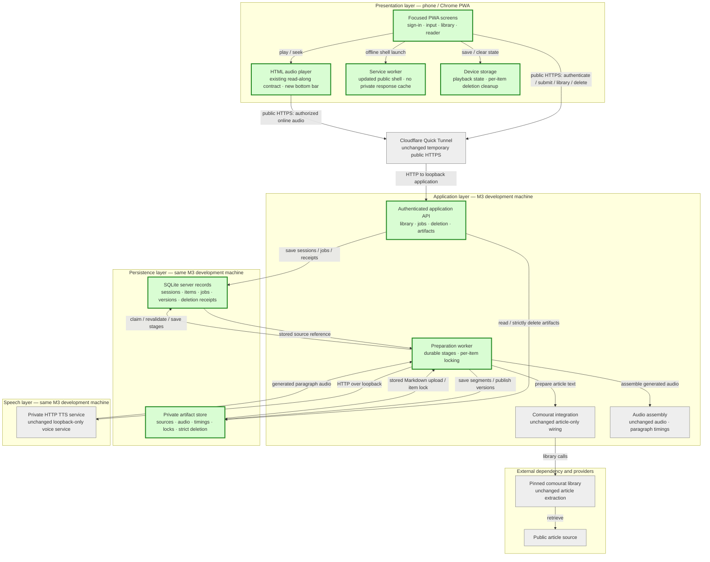
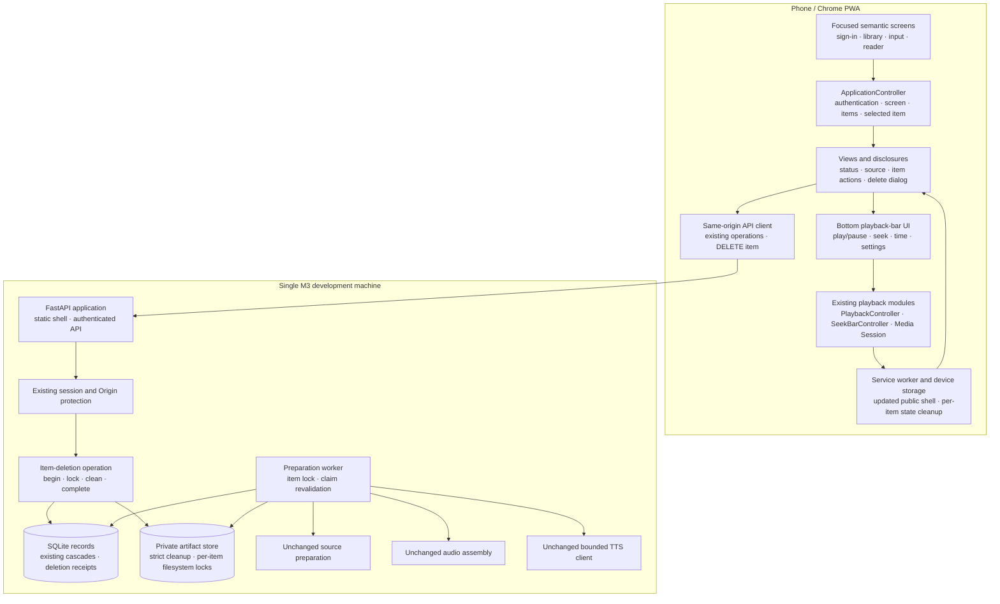
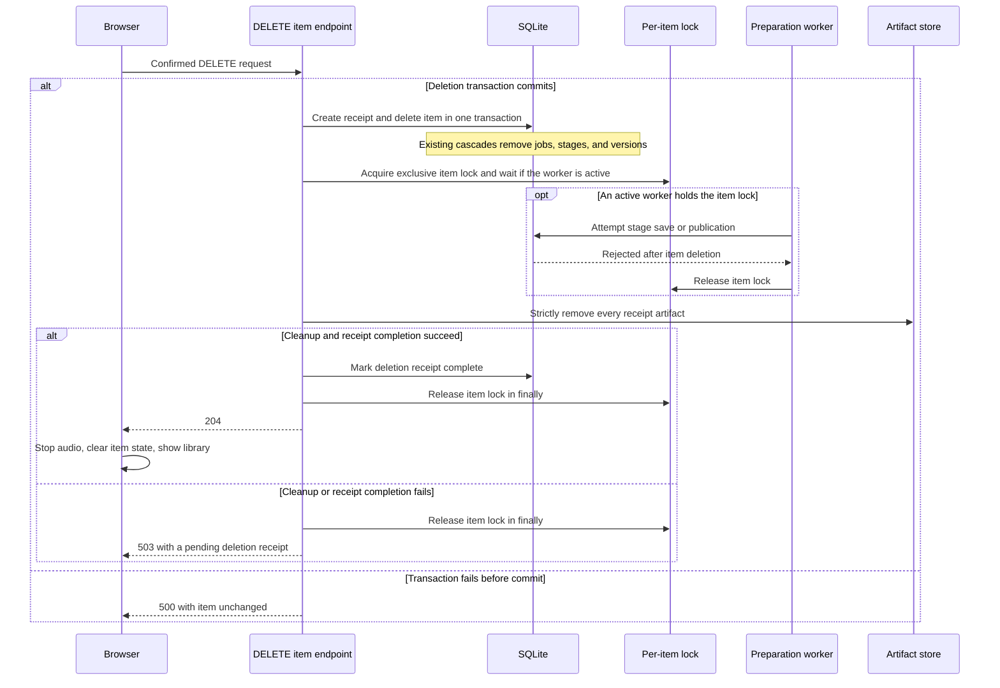

## Practical mobile interface general spec

### 1. Executive summary

#### 1.1 Spec description

This spec delivers a practical and visually coherent mobile interface for the existing Vesna article and Markdown application. It separates the personal library, content input, and item reader into focused screens and gives the reader a persistent bottom playback bar. It simplifies source inspection, preparation states, errors, and playback settings, and adds authenticated item deletion with confirmation while preserving the existing M3 API, preparation, playback, and state-restoration contracts. It adds no source types or real-item offline storage and does not require a frontend framework migration.

#### 1.2 Spec motivation

M3 made Vesna functional, but its single long page, duplicated controls, expanded source content, and technical status messages make routine listening difficult. A dedicated interface milestone will improve everyday use before new source types and offline features add more complexity. Item deletion is included because a saved library is difficult to use when unwanted items cannot be removed.

#### 1.3 Implementation repos

- `anton-pershin/vesna`: management repository and implementation repository for the PWA interface, item-deletion operation, browser and server tests, and target-phone verification evidence.
- No other implementation repository is expected. Comourat remains pinned and unchanged. Existing API contracts, preparation behavior, TTS behavior, and stored prepared versions remain compatible; the only planned API addition is item deletion and its associated preparation-worker safety behavior.

### 2. Requirement analysis

#### 2.1 Functional requirements

**FR1. Focused screens and navigation**

Provide separate sign-in, personal-library, content-input, and reader screens. Use the personal library as the authenticated home screen. Let the user open the content-input screen, open an item, and return to the library without displaying unrelated sections on the same long page. Keep sign-out accessible. Navigation must not cancel accepted preparation or discard saved playback state unless the user confirms item deletion.

**FR2. Article and Markdown submission**

Keep public article URL submission and UTF-8 `.md` or `.markdown` upload on the content-input screen. Preserve the M3 validation, size limits, inert-content handling, and API operations. Prevent duplicate submissions while a request is pending. Show a clear result and open the accepted item so the user can follow its preparation. Do not add Reddit, arXiv, PDF, or DOCX input.

**FR3. Compact personal library**

Display each saved item once with its title, source type, and concise preparation state. Distinguish accepted, preparing, ready, and failed items without technical language. Keep automatic status refresh and basic retry behavior. Provide a clear empty state with an action to add the first item. Full source URLs, filenames, and error details must remain available without making every library entry unnecessarily large.

**FR4. Focused reader and source inspection**

Display the item title, concise preparation state, listening text, current-paragraph indication, and paragraph-selection controls in the reader. Provide source information through an explicit source action. For Markdown items, provide the original text and file download on demand rather than expanded before the player. Continue to render untrusted content as inert text.

**FR5. Persistent bottom playback bar**

For an open item with a playable prepared version, provide a bottom playback bar that remains visible while the user scrolls the reader. Display only one visible set of audio controls; do not show duplicate native and custom controls. Provide a single play/pause control, seeking, elapsed and total time, and previous/next paragraph controls. Put playback speed and automatic scrolling in a compact expandable settings area. The bar must not cover listening text, the final paragraph, or other controls. Remove the bar when the item closes or has no playable prepared version.

**FR6. Playback and read-along behavior**

Preserve the existing HTML audio playback model and M3 API and prepared-version contracts. Preserve playback from a selected paragraph, highlighting, seeking, speed changes, saved position and speed, Media Session behavior, and return from background playback. Opening screens, refreshing library states, or changing interface settings must not unexpectedly restart playback, create a second audio stream, or reset the playback position. Confirmed item deletion intentionally stops playback and clears the deleted item's local playback state.

**FR7. Clear states and errors**

Use concise, user-oriented messages for routine sign-in, submission, preparation, playback, and restoration states. Keep preparation states distinct and never present incomplete or failed output as ready. Give failures a clear next action, including retry where supported. Remove internal media states, prepared-version identifiers, and other diagnostic details from routine messages. Error messages must remain safe and must not expose credentials or private implementation details.

**FR8. Item deletion**

Provide an item menu in the reader with a `Delete item` action. Require a confirmation that names the item and explains that its saved content and audio will be removed. Cancellation must leave the item and playback unchanged. On success, stop its playback, clear its local playback state, remove it from the library, and delete its source content, original Markdown, prepared text, audio, timing data, and associated artifacts from server storage. Return the user to the library after confirmed deletion.

Use an authenticated same-origin deletion operation. For an accepted or preparing item, prevent subsequent publication and discard output produced by an already running operation so the item cannot reappear when the worker completes. A failed or uncertain deletion must not be reported as complete. Repeated deletion requests must be safe and must not affect another item.

#### 2.2 Non-functional requirements

**NFR1. Visual quality and responsive layout**

Use consistent typography, spacing, colors, icons, borders, and control styles across all screens. Establish a clear visual hierarchy that prioritizes the listening text and primary actions, with fewer nested panels and less decorative bordering than M3. Design for the target phone first and provide a usable desktop layout. Prevent horizontal page overflow at 320 CSS pixels and on the target phone, including with long titles, URLs, filenames, and error messages. The bottom playback bar must adapt to the available viewport and device safe areas.

**NFR2. Accessibility**

Provide semantic controls, accessible names, visible keyboard focus, and logical focus movement when screens open or close. Use touch targets of at least 44 by 44 CSS pixels for primary controls. Maintain contrast ratios of at least 4.5:1 for normal text and 3:1 for large text and control boundaries. Do not communicate the current paragraph or preparation state only through color. Support reduced-motion preferences and 200% text scaling without loss of content or control access. Dynamic status announcements must be useful and must not repeat continuously during playback. The deletion confirmation must be keyboard and screen-reader accessible and must make the destructive action clear.

**NFR3. Interaction and playback robustness**

A playback action must update its visible control state without waiting for an unrelated library refresh. Polling and screen rendering must not reset input focus, playback settings, open source panels, or the user's reading position. The current-paragraph indication must remain correct and visibly update within one second of a tested current-paragraph transition while the application is in the foreground. Preserve locked-screen and background playback behavior. Scrolling and visual transitions must not trigger content preparation or additional audio requests. Item deletion must not interrupt another item's preparation or playback, and a deleted item must not be published again by an incomplete job.

**NFR4. Security and privacy**

Preserve M3 authentication, session expiration, sign-out clearing, Origin checks, and authenticated artifact access. Render retrieved and uploaded content without executing scripts or injecting source HTML. Do not place authentication responses, private API responses, source content, or prepared artifacts in new browser caches. External source links must use safe protocols and opener isolation. Private item content must be removed from visible screens when authentication ends. Require authentication and same-origin protection for deletion, and deny access to deleted source content and artifacts after successful deletion.

**NFR5. Maintainable presentation structure**

Keep canonical browser modules under `public/modules/`, with semantic HTML and shared CSS for the visual design. Separate screen rendering, interface state, API operations, and playback behavior sufficiently to prevent duplicated state or layout-dependent playback logic. Reuse the existing player, timing, storage, and Media Session contracts. Do not introduce a frontend framework, runtime package manager dependency, or additional service unless the Overall solution design justifies it and the user approves it. Keep item-deletion coordination in the server application rather than browser code.

**NFR6. Reproducible verification and evidence**

Use deterministic tests with controlled API responses and prepared-item fixtures for screen states, navigation, playback controls, accessibility attributes, and failure behavior. Use controlled server fixtures to test deletion in every preparation state and during an in-flight operation. Run browser checks at representative phone and desktop viewport sizes without external services or credentials. Verify the complete article and Markdown input-to-listening workflows on the target phone, including preparation states, reader navigation, bottom-bar controls, source inspection, playback restoration, background playback, and deletion of a disposable item. Record exact commits, browser and phone versions, reproduction steps, sanitized screenshots where useful, and explicit pass, fail, or blocked outcomes.

### 3. Acceptance criteria

**AC1. Screen navigation and content submission**

Covers FR1–FR2, NFR3, and NFR6.

- Automated tests verify sign-in, sign-out, the library home screen, navigation to content input, opening an item, and returning to the library. Unrelated sections are not rendered together as one long page.
- Article and Markdown forms preserve all M3 validation and API requests. Pending submissions cannot create duplicate items.
- An accepted submission opens its item and shows its preparation state. Leaving the screen or returning to the library does not cancel server-side preparation or erase saved playback state.
- Reddit, arXiv, PDF, and DOCX inputs are not introduced.

**AC2. Library and status presentation**

Covers FR3 and FR7, NFR3, and NFR6.

- Controlled fixtures verify empty, accepted, preparing, ready, and failed library states. Each item appears once with its title, source type, and concise state.
- The empty state provides a working add-content action. Ready items open the reader, and failed items expose the existing same-item retry operation.
- Automatic refreshes do not duplicate entries, reset playback settings, close source panels, move input focus unexpectedly, or change the user's reading position.
- Controlled fixtures cover concise sign-in, submission, preparation, playback, and restoration messages and their failure states. Each failure provides a clear next action where one is available and is not presented as success.
- Routine messages contain no raw media state, prepared-version identifier, stack trace, credential, or private implementation detail.

**AC3. Reader, source inspection, and deletion interaction**

Covers FR4, FR7–FR8, NFR2, NFR4, and NFR6.

- Article and Markdown fixtures display the correct title, preparation state, listening text, paragraph controls, and current-paragraph indication.
- Source information is hidden from the initial reader layout and becomes available through an explicit action. The full article URL or uploaded filename and the complete safe preparation-error message remain available on demand. Original Markdown text and its download remain available on demand.
- Script-bearing article text and Markdown execute no script and inject no source HTML.
- Preparing and failed items remain inspectable. Playback controls appear only when a playable prepared version exists.
- Opening source information or receiving a library refresh does not reset the reader's scroll position or dismiss an open source panel.
- The reader item menu exposes `Delete item`. Its accessible confirmation names the item and explains the destructive result. Cancel and Escape leave the item, playback, and saved state unchanged.
- A successful deletion stops playback, clears the item's local playback state, closes the reader, and removes exactly that item from the library. While the user remains authenticated, a failed or uncertain deletion keeps the last rendered reader available, displays no false success message, and permits an explicit sequential retry after the request settles.
- Sign-out, session expiration, or a `401` response closes the deletion dialog and clears private screens even when a deletion request is unresolved. A late response cannot restore private content. Confirmed deletion may clear only the targeted local playback state without rendering item data after authentication ends.
- Deletion and navigation invalidate older library, item, source, and playback-read completions. Tests hold a pre-deletion response until after deletion succeeds and verify that it cannot restore the item, reader, audio, or playback state.

**AC4. Bottom playback bar and preserved playback**

Covers FR5–FR6 and NFR3.

- Browser tests verify that the bottom playback bar remains visible and usable at the top, middle, and bottom of a long reader. Only one visible set of audio controls is present.
- The bar provides a correctly labelled play/pause toggle, seeking, elapsed and total time, and previous/next paragraph controls. Speed and automatic scrolling are available in an expandable settings area.
- The final paragraph and all reader controls remain visible above the bar. Closing the item removes the bar.
- Automated playback tests and real Chromium checks verify play/pause, seeking, paragraph navigation, selected-paragraph playback, speed changes, highlighting, automatic scrolling, and saved position and speed after reopening.
- Navigation and polling do not reset playback or create a second audio stream. The visible current-paragraph indication updates within one second of each tested current-paragraph transition while the application is in the foreground, including after seeking and returning from background playback.
- With a controlled library response still pending, play/pause updates both the visible control state and the audio action without waiting for that response.

**AC5. Responsive design and accessibility**

Covers NFR1–NFR2 and NFR6.

- Browser checks cover at least 320-pixel and representative phone-width viewports plus a desktop viewport. Fixtures include long titles, URLs, filenames, paragraphs, and error messages. None causes horizontal page overflow.
- Screens remain usable at 200% text scaling or browser zoom, with no loss of content or access to controls.
- Automated checks and manual inspection verify accessible names, semantic controls, logical focus movement, visible focus, and useful status announcements. Playback time updates do not cause continuous screen-reader announcements.
- Primary touch targets measure at least 44 by 44 CSS pixels.
- Measured contrast is at least 4.5:1 for normal text and 3:1 for large text and enabled-control boundaries. Current-paragraph and preparation states also have non-color indications.
- Reduced-motion mode disables nonessential animation and animated scrolling.
- The deletion confirmation traps focus while open, restores focus when cancelled, and clearly labels its destructive button.
- Sanitized screenshots demonstrate a consistent visual hierarchy and control style across sign-in, content input, library, reader, source inspection, deletion confirmation, and failure states.

**AC6. Regression, deletion safety, security, and maintainability**

Covers FR8, NFR3–NFR6, and the M3 preservation requirements in FR1–FR6.

- All deterministic JavaScript and affected Python tests pass in CI without external services, credentials, or target-phone access.
- Existing API, authentication, upload, prepared-version, playback-state, Media Session, and service-worker contract tests continue to pass.
- Deletion tests cover accepted, preparing, ready, and failed items. They verify removal of source content, original Markdown, prepared text, audio, timing data, and associated artifacts without affecting another item.
- Controlled race tests cover deletion after the database claim but before lock revalidation, during source retrieval, during TTS, during assembly, after filesystem publication but before database publication, and immediately after database publication. Preparation either stops before its next operation or finishes its current operation and has its output discarded. It cannot publish, recreate, or leave late artifacts for a deleted item.
- API tests cover initial and repeated `204`, unknown-item `404`, pre-commit `500` with the item unchanged, post-commit `503` with a pending receipt followed by resumed cleanup and `204`, concurrent repeated requests, and a lost response followed by a successful repeated request. Every case leaves other items unchanged.
- Browser tests cover a lost deletion response followed by an explicit sequential retry, sign-out with an unresolved deletion request, a late `401`, and stale library, item, source, and playback responses. No late response restores private content or a deleted item.
- Tests verify session-expiration and sign-out clearing, safe external links, inert untrusted content, same-origin deletion protection, denial of deleted artifacts, and the absence of private responses in Cache Storage.
- Browser checks confirm that scrolling and visual transitions do not start preparation or produce additional audio requests.
- If shared playback, storage, timing, Media Session, or service-worker modules change, the corresponding isolated M1 regression procedures pass again. These procedures do not establish real-item offline readiness.
- Code review confirms that canonical modules remain under `public/modules/`, playback behavior is not duplicated in layout code, deletion coordination remains on the server, and no unapproved framework, runtime dependency, or service was introduced.

**AC7. Live browser and target-phone verification**

Covers FR1–FR8, NFR1–NFR4, and NFR6.

- The explicit live Chromium runner passes for real prepared article and Markdown items at phone and desktop viewport sizes. It covers navigation, source inspection, bottom-bar operation, real audio decoding and playback, restoration, accessibility-critical attributes, overflow, deletion, and private-cache exclusion.
- On the target phone, the user completes both article and Markdown input-to-listening workflows through the HTTPS application. The checks cover sign-in, submission, preparation states, library navigation, source inspection, reader scrolling, all bottom-bar controls, selected paragraphs, speed, automatic scrolling, saved state after reopening, and return to the library.
- On the target phone, cancellation leaves a disposable item unchanged. Confirmed deletion removes that item, stops its playback, clears its saved state, and prevents its source and audio from being retrieved again.
- A real prepared item continues playing when another app is in the foreground and when the screen is locked. Lock-screen and headset controls are checked where exposed; unavailable controls are recorded rather than presented as working.
- The user inspects the final interface on the target phone and confirms that the visual result and routine workflows are acceptable.
- Record the phone operating-system and Chrome versions, browser version, temporary public origin, tested commit, and explicit results. No real-item offline-readiness claim is made.

**AC8. Evidence and milestone decision**

Covers all functional and non-functional requirements and the M4 roadmap result.

- `evidence/practical-mobile-interface/` contains exact commit and environment identities, automated results, live browser results, target-phone records, reproduction instructions, and sanitized screenshots.
- Each AC1–AC7 result has an explicit pass, fail, or blocked outcome. An unperformed or blocked required check is not a pass.
- Evidence contains no password, session cookie, authentication response, private generation endpoint, or unintended private content.
- M4 passes only when every AC1–AC7 check passes and independent implementation review has no no-pass items.
- The milestone decision does not mark Reddit/arXiv support, real-item offline storage, advanced retries, or split-host deployment as complete.

### 4. Insight

All three options retain the approved separate screens, focused reader, and persistent bottom playback bar. They differ in visual character, typography, and information density, not in backend behavior. The deletion interaction is the same in every option: an item menu beside `Source`, an explicit `Delete item` action, and an accessible confirmation.

#### 4.1 Option A — Calm editorial

This option makes Vesna feel closer to a well-designed reading application than a technical dashboard.

- Colors: warm off-white background, near-black text, and a restrained forest-green or teal accent.
- Typography: a highly readable serif font for listening text, with the system sans-serif font for headings and controls. Use fonts already available on the device; no font download is needed.
- Library: a clean list with subtle separators, small source labels, and restrained status badges rather than heavily bordered cards.
- Reader: generous line spacing, comfortable paragraph widths, and minimal surrounding decoration. The current paragraph receives a soft tinted background, a side marker, and a text label.
- Playback bar: a light elevated surface with a subtle shadow, a prominent green play/pause button, simple icons, and a slim seek control.
- Overall impression: calm, spacious, readable, and content-focused.

Advantages: excellent long-form reading comfort; a clear improvement over the current visually heavy interface; straightforward to implement consistently.

Trade-off: a single light appearance is less suitable for users who specifically prefer a dark interface at night.

The mobile variations compared under this option were A1 Warm paper, A2 Bright minimal, and A3 Soft sage. A1 uses an ivory background, forest-green accents, classic serif listening text, and a softly rounded playback bar. A2 uses a clean white background, deep teal accents, sharper surfaces, and minimal decoration. A3 uses a green-gray background, tonal surfaces, and softer controls.

#### 4.2 Option B — Dark listening studio

This option retains a dark appearance but replaces the current blue-heavy, border-heavy styling with a more deliberate media-player design.

- Colors: neutral charcoal surfaces, soft white text, and one warm accent such as amber or muted lime.
- Typography: clean sans-serif text throughout, with slightly larger listening text and relaxed line spacing.
- Library: compact dark rows with subtle tonal separation instead of outlines around every element.
- Reader: minimal decoration, with the current paragraph identified by a soft elevated surface, accent line, and text label.
- Playback bar: a darker elevated surface with larger media-style controls and a prominent accent-colored play/pause button.
- Overall impression: focused, modern, and closer to a podcast or music application.

Advantages: comfortable in low-light environments; gives playback controls a strong visual identity; preserves a dark interface without preserving the current visual problems.

Trade-offs: long-form text can feel heavier on a dark background; the result would be a less substantial visual departure from M3.

The mobile variations compared under this option were B1 Charcoal amber, B2 Midnight mint, and B3 Graphite lime. Each uses the same reader layout and controls with a different dark palette.

#### 4.3 Option C — Compact native utility

This option makes Vesna resemble a conventional Android utility and follow the device's light or dark preference.

- Colors: neutral system-oriented surfaces with a single accent color and separate light/dark palettes.
- Typography: system sans-serif throughout.
- Library: denser rows, compact status chips, and familiar Android-style navigation.
- Reader: functional rather than editorial, with less decorative spacing and no separate reading typeface.
- Playback bar: a rectangular, native-looking control surface with familiar media symbols.
- Overall impression: practical, compact, and familiar rather than distinctive.

Advantages: efficient use of screen space; familiar interaction patterns; automatic support for light and dark preferences.

Trade-offs: less reading-focused and less visually distinctive; two themes require additional design and verification work.

#### 4.4 Comparison and selected approach

| Consideration | Calm editorial | Dark listening studio | Compact native utility |
|---|---|---|---|
| Long-form reading comfort | Excellent | Good | Good |
| Playback identity | Restrained | Strong | Familiar |
| Visual departure from M3 | Strong | Moderate | Strong |
| Screen density | Comfortable | Comfortable | Compact |
| Low-light use | Adequate | Excellent | Depends on device theme |
| Implementation and verification scope | One appearance | One appearance | Two appearances |

Select **Option A1 — Warm paper**. The user compared the A and B mobile reader variations, selected A1, and approved the matching A1 library and add-content designs.

Vesna's central activity is reading and listening for extended periods, so reading comfort guides the design. A quiet editorial interface directly addresses the current problems: excessive borders, competing panels, technical visual noise, and weak separation between content and controls.

The selected design uses warm neutral surfaces and one restrained accent color; serif listening text and sans-serif interface controls; lists and separators instead of nested bordered cards; a light, elevated bottom playback bar; and simple local icons and device-available fonts. It uses one carefully verified appearance rather than spreading effort across multiple themes. No new frontend or font dependency is required.

### 5. Overall solution design

#### 5.1 High-level design

The following diagram retains the M3 single-machine deployment. Green components are created or changed by this spec. Comourat, article extraction, audio assembly, TTS, and Quick Tunnel behavior remain unchanged.



No new service, frontend framework, router, font download, or package-manager dependency is required.

Use shared CSS tokens based on the approved A1 Warm paper mockups:

- Background: `#f7f3eb`.
- Surface: `#fffdf8`.
- Primary text: `#26332d`.
- Muted text: `#656c64`.
- Accent: `#276f58`.
- Dark accent: `#1d5b47`.
- Accent-soft surface: `#e4eee5`.
- Enabled-control border: `#7d847b`.
- Warning text: `#7b5825`.
- Error text: `#984e41`.

The muted text, warning text, and control borders are slightly darker than the initial mockup colors to satisfy the approved contrast requirements. Decorative separators may remain lighter.

Use device-available serif fonts for listening text and system sans-serif fonts for interface controls. Use local inline SVG icons with accessible text labels. Update the PWA theme and icons to match A1.

Use a three-row application layout:

1. A compact application header.
2. A scrollable active screen.
3. The bottom playback bar when a playable item is open.

The reader scrolls in the middle row. The playback bar is outside that scroll container, so it remains visible without covering the final paragraph. Expanding playback settings reduces the available reader height instead of placing another panel over the text. Use dynamic viewport units and device safe-area padding.

The component design is:



Extend `ApplicationController` as the single source of authentication, library, selected-item, and active-screen state. Do not add a second navigation-state store or a URL-routing contract. Explicit interface controls move between screens; polling updates data without recreating the active screen, moving focus, or closing disclosures.

Use native disclosures for source information, item actions, and playback settings. On the content-input screen, use the approved `Article URL` and `Markdown file` selector so only one form is visible at a time. Use a native modal dialog for deletion confirmation, with initial focus on `Cancel`. The item action beside `Source` opens a small disclosure containing `Delete item`; it is not a swipe or long-press action.

Keep the HTML audio element and existing `PlaybackController`, `SeekBarController`, timing, and Media Session contracts. Remove only the visible native controls. A thin playback-bar UI delegates operations to the existing player and reflects its actual state.

Add a per-item removal operation to `ItemPlaybackStateStore`. It removes every saved prepared-version state for the deleted item without touching another item's state.

Add the following authenticated same-origin operation:

```http
DELETE /api/items/{item_id}
```

A new SQLite migration adds an `item_deletions` table. Each deletion receipt contains only the owner and item identifiers, required artifact identifiers, creation time, and optional completion time. It contains no title, URL, filename, source text, listening text, audio, or credentials.

The selected deletion sequence is:



The worker wraps its complete claimed operation in the same per-item filesystem lock and revalidates its lease after acquiring that lock. The API and worker use `fcntl.flock` on the existing Linux single-machine deployment. Lock files remain in place; removing a lock file could create two independent locks for waiting processes. Because the API deletes the item before it waits for the worker lock, the worker's next stage save fails and the worker exits after its current operation. The API does not wait for all remaining paragraphs.

The receipt records the original source file, candidate work and staging trees, the unpublished candidate-version tree, and every published-version tree. This includes output that an in-flight source request, TTS request, or audio assembly may create immediately before deletion obtains the lock.

Publication has two safe outcomes:

- Publication commits before deletion, so its version is included in the deletion transaction and artifact cleanup.
- Publication is attempted after item deletion, so the existing live-job checks reject it.

Strict artifact cleanup treats missing files as success but raises other filesystem errors. Existing best-effort cleanup helpers remain unchanged for their current uses.

Responses are:

- `204`: the item is already logically deleted and all receipt cleanup is complete.
- `404`: the item and deletion receipt are unknown to the authenticated owner.
- `401` or `403`: existing authentication or same-origin protection denies the request.
- `500`: the initial database transaction did not commit, the item is unchanged, and a sanitized message permits retry.
- `503`: logical deletion has committed, but physical cleanup or receipt completion is incomplete. The pending receipt allows the same request to resume cleanup safely.

A failed database transaction before the deletion commit leaves the item unchanged. A filesystem failure after that commit cannot honestly restore a fully usable item; the item remains inaccessible and the deletion remains retryable. This is why the API never reports success before cleanup completes.

While a deletion request is in flight, the browser disables duplicate deletion requests and suspends automatic library and selected-item polling. Deletion and navigation advance an operation-generation counter that invalidates older library, item, source, and playback-read completions. An existing `refreshPromise` may finish, but its stale result is discarded rather than applied.

While authenticated, the browser retains the last rendered reader without claiming that the item remains present on the server. After a request fails or its outcome is uncertain, polling remains suspended until the user leaves the reader, confirms deletion, or makes one explicit sequential retry with the same item identifier. Responses have these browser outcomes:

- `204`: stop audio, clear the item's local playback state, close the reader, remove exactly that item from the library, and show a deletion confirmation.
- `404`: the server has no item or deletion receipt. Do not claim confirmed cleanup. Keep the last rendered reader with a safe not-found message until the user leaves; the next library view contains no such item.
- `500`: the deletion did not commit, so keep the unchanged item and reader available and show a retryable error.
- `503`: logical deletion committed but cleanup is incomplete. Keep the last rendered reader with a retry-cleanup message; the next library view contains no such item.
- `403`: deletion did not start. Keep the item and reader available and show a safe request-denied message.

Sign-out, session expiration, or a `401` response closes the deletion dialog and clears private screens, including when a request is unresolved. Late responses cannot render or restore private content. A late known `204` may clear only the targeted local playback state without rendering item data. No stale read or late deletion response can reinsert the item into the library or restart its audio.

The synchronous operation may wait for the current bounded source, TTS, or assembly operation. For this single-user deployment, that is simpler than adding a deleting item state, background cleanup service, and polling contract. No provider cancellation API or general outcome-unknown retry behavior is introduced.
