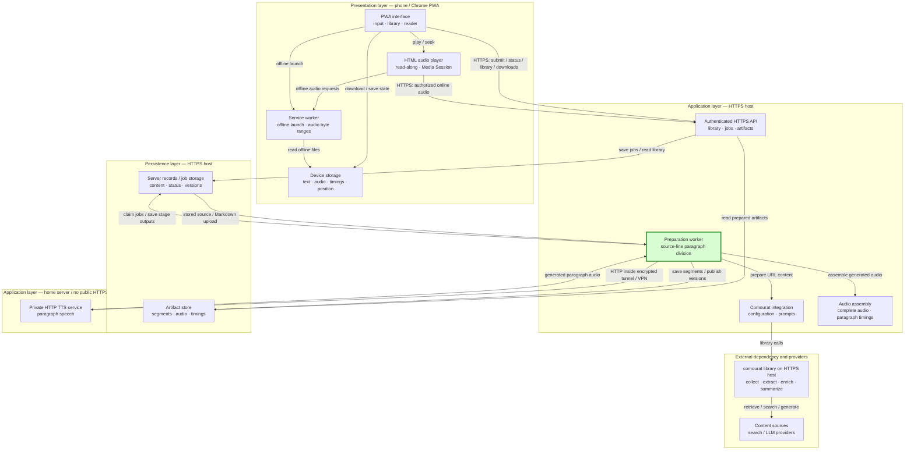

## Preserve paragraph boundaries KISS spec

### 1. Requirement analysis

**R1. Extracted article paragraphs**

Divide extracted article text at every non-empty line after newline normalization. A heading, paragraph, or list item separated from adjacent text by one newline must become a separate listening paragraph. Keep the pinned comourat extraction behavior unchanged. This requirement also applies to GitHub repository pages because they use the generic article path.

**R2. Uploaded Markdown paragraphs**

Apply the same newline rule to uploaded Markdown. Documents with single newlines and documents with blank-line separators must retain their non-empty source lines as separate listening paragraphs. Preserve the existing Markdown cleanup, inert HTML handling, and prohibition on linked-resource retrieval.

**R3. Paragraph identity and whitespace**

Give paragraphs sequential identifiers `p0`, `p1`, and so on. Discard lines that are empty after the existing plain-text cleanup. Normalize whitespace inside each paragraph without joining adjacent source lines. Normalize CRLF and CR newlines before paragraph division.

**R4. Audio, timing data, and limits**

Request TTS once for each resulting paragraph. Produce one matching timing entry for each paragraph and apply the character limit to each resulting paragraph. Keep the existing audio assembly, prepared-version publication, paragraph selection, highlighting, and navigation contracts unchanged.

**Expected behavior variants**

- **B1:** An extracted article with single-LF separators produces the same number of listening paragraphs as its non-empty extracted lines.
- **B2:** An article or Markdown document with blank-line separators retains its existing paragraph text and order.
- **B3:** Markdown with single-newline separators produces separate listening paragraphs without fetching linked resources.
- **B4:** Mixed LF, CRLF, CR, blank lines, and whitespace-only lines produce no empty paragraphs and do not merge adjacent non-empty lines.

### 2. Tests

**T1. Real pinned-extractor article preparation**

Use `comourat.enrichment.page_fetch.extract_main_content` with controlled HTML that contains one heading and three substantial paragraphs. Assert that the real extracted text contains four expected lines separated by single LF characters. Pass that unmodified text through the article adapter, worker, controlled TTS, real audio assembly, and public API. Set the worker character limit to the longest expected paragraph so the incorrectly joined article would fail validation. Assert exact paragraph texts and identifiers, a paragraph count of four, four TTS calls with the same texts, four matching timing entries, and consistent final audio duration. This test covers R1, R3, R4, and B1. The test submits a GitHub repository URL through the generic article path used for all articles.

**T2. Newline and cleanup unit coverage**

Call `plain_paragraphs()` with Markdown headings, paragraphs, and list items that use single newlines, blank lines, CRLF, and CR. Assert exact paragraph texts, sequential identifiers, Markdown cleanup, and absence of empty paragraphs. This test covers R2, R3, B2, B3, and B4.

**T3. Markdown preparation without blank lines**

Run the complete Markdown preparation path with a heading and two paragraphs separated by single newlines. Assert exact listening paragraphs, one TTS request per paragraph, matching timing count and identifiers, unchanged original Markdown bytes, and a ready prepared version. This test covers R2, R3, R4, and B3.

**T4. Existing regression coverage**

Run all Python and JavaScript tests and syntax checks. Existing blank-line fixtures cover B2. Existing audio and browser tests confirm that audio assembly, timing validation, paragraph selection, highlighting, and navigation continue to consume the preserved paragraph and timing contracts.

### 3. Implementation plan

#### 3.1 Implementation repos

- `anton-pershin/vesna`: management and implementation repository for the specification, plain-text preparation, and regression tests.
- `anton-pershin/comourat`: pinned external dependency used unchanged by the real-extractor regression test. No code change or dependency issue is required.

#### 3.2 High-level design

The preparation worker on the HTTPS host is the only changed application component. Green identifies the changed component.

Keep newline handling inside the existing plain-text preparation component. Process each current blank-line section through the existing Markdown and inert-HTML cleanup before dividing its cleaned text into lines. This order retains cleanup state across source lines, including fenced code and HTML tags. Normalize whitespace within each cleaned line and publish each non-empty line as one paragraph.

#### 3.3 Todo list

1. [ ] Write the real-extractor, newline-unit, and single-newline Markdown tests.
2. [ ] Run the focused tests and ensure that the new boundary assertions fail.
3. [ ] Change plain-text preparation to retain each cleaned non-empty line as a paragraph.
4. [ ] Run the focused tests and complete Python and JavaScript checks.
5. [ ] Review the specification and implementation diff for scope, consistency, and sensitive information.
6. [ ] Push the assigned branch, open a draft pull request, and wait for required CI on its exact head.
7. [ ] Mark the pull request ready only after local checks and CI pass.

#### 3.4 Modification summary

| File | Action |
|------|--------|
| `.internal/specs/11-preserve-paragraph-boundaries-kiss-spec.md` | New: define the boundary contract and verification plan. |
| `server/src/vesna/text.py` | Modified: preserve cleaned newlines as paragraph boundaries. |
| `server/tests/test_e2e.py` | Modified: use real pinned-extractor output and single-newline Markdown through complete preparation. |
| `server/tests/test_inputs_api.py` | Modified: cover mixed newline conventions and exact paragraph boundaries. |
