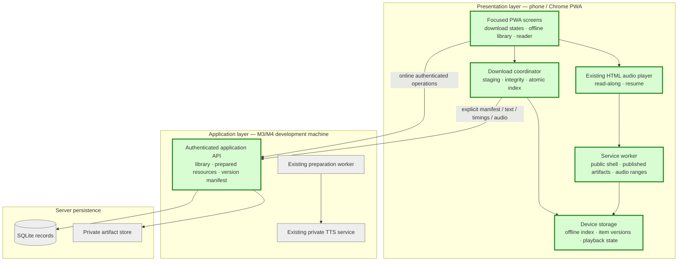
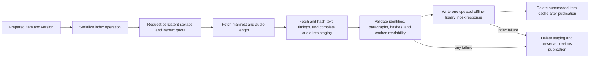
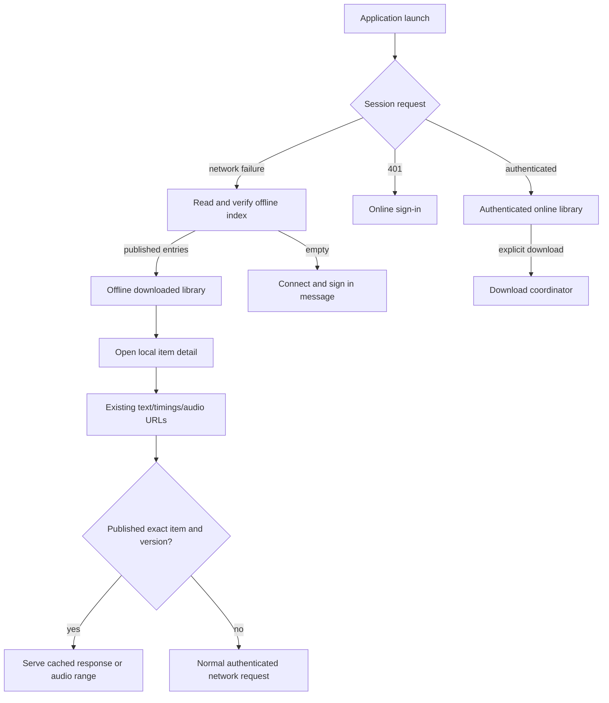

## Offline library and playback general spec

### 1. Executive summary

#### 1.1 Spec description

This spec implements issue #13 and the current-source-type portion of roadmap milestone M6. A signed-in user can explicitly download one prepared article or Markdown item. After a complete download, the installed PWA can close, reopen without network access, show the downloaded library, and play the item with the existing reader and playback controls. Downloads use verified prepared versions, atomic publication, device-storage controls, and clear recovery states.

The investigation is `.internal/investigations/offline-library-and-playback.md`. The separate intermittent failure to load the public shell is excluded from this spec.

#### 1.2 Spec motivation

The M4 application can open its public shell offline, but startup still requires a session request and every library and playback read requires the server. This prevents the core offline listening behavior required by constitution FR9–FR11 and AC6. The M1 probe has already verified the high-risk browser playback and cache mechanisms with a synthetic fixture; this spec applies those mechanisms to real prepared items without presenting partial or lost data as ready.

#### 1.3 Implementation repos

- `anton-pershin/vesna`: management and implementation repository for the browser download coordinator, offline application state, service worker, authenticated integrity-manifest API, user interface, tests, and evidence.
- No other implementation repository is involved. Comourat remains pinned and unchanged. No new runtime service, frontend framework, or package dependency is introduced.

### 2. Requirement analysis

#### 2.1 Functional requirements

**FR1. Explicit per-item download**

Provide a labelled download action on each open prepared item while online. Do not download items automatically. Show distinct downloading, offline-ready, update-available, failed, and missing-data states. Repeated activation of one pending download shares the same operation. A download uses the item ID and prepared version returned by the authenticated API.

**FR2. Complete and version-consistent device copies**

Download the authenticated version manifest, listening text, complete audio, and paragraph timing data. Validate item identity, version identity, paragraph structure, declared artifact hashes, and nonempty audio before publication. Use a separate staging cache and one atomic offline-library index update. An interrupted or invalid replacement leaves the previous published version usable. Never combine artifacts from different prepared versions.

**FR3. Offline library and startup**

When the initial session request fails because the network is unavailable, read the published device index and show its downloaded items. Do not require a password, server session, authentication response, or online library response. A server `401` response remains an online authentication requirement and must not be reinterpreted as offline access. If no usable downloads exist, explain that the user must connect and sign in. If an index entry has missing resources, report the lost download and do not mark it offline-ready.

**FR4. Offline reader and playback**

Open a published item from the offline library. Load its downloaded text, timings, and complete audio through the existing same-origin URLs and service worker. Preserve play/pause, direct seeking, previous/next paragraph, selected-paragraph playback, speed, current-paragraph highlighting, automatic scrolling, Media Session behavior, and saved position and speed. Serve valid single audio byte ranges from the cached complete response. Do not require original Markdown or source inspection offline.

**FR5. Device storage controls and deletion**

Let the user remove a device download without deleting the server item. Removing a download makes it unavailable to subsequent offline launches and attempts to free its item cache. Confirmed server-item deletion also removes the local download and the existing playback state on the requesting device. Failure to clean an orphan cache must not make a removed or deleted item accessible through the published index.

**FR6. Online reconciliation and replacement**

After an authenticated online library response, attach local download state to matching server items. If the server published a different version, preserve the old download until an explicit replacement succeeds and show that an update is available. Remove local publications whose item no longer exists in the authoritative authenticated library. Online playback uses the current server version; offline playback uses the published device version. Sign-out and session expiration clear online private views but do not silently erase explicit device downloads. Removal of a device download is the explicit action that revokes its offline availability on that device and origin.

#### 2.2 Non-functional requirements

**NFR1. Security and privacy**

Use authenticated same-origin requests for downloads. Cache only explicitly downloaded prepared resources and their required item metadata. Do not cache passwords, cookies, session identifiers, authentication responses, generation endpoints, or unrelated API responses. Continue to render item metadata and listening text as inert text. Cross-origin and mutating requests bypass offline retrieval.

**NFR2. Storage reliability and recovery**

Request persistent browser storage during an explicit download where supported. Report denial or failure without claiming permanent retention. Use available quota information and a HEAD audio length when supported for an early insufficient-space error; handle later quota and cache-write failures as well. No partial download is published. Detect missing published resources before showing offline-ready state. Document that browser clearing, uninstallation, origin changes, and operating-system removal can destroy downloads.

**NFR3. Update and concurrency safety**

Serialize download-index changes with Web Locks where available and a local queue otherwise. Keep shell-cache cleanup separate from item caches and the offline index. A service-worker update must preserve published downloads and active playback. A failed old-cache cleanup leaves only an unreachable orphan and must not corrupt the active publication.

**NFR4. Responsive and accessible interaction**

Preserve the A1 interface and existing playback behavior. Download and removal controls must have accessible names, visible focus, safe status announcements, and touch targets consistent with the existing primary controls. Offline mode must disable or hide network-only input, retry, deletion, and source operations rather than offering actions that cannot work.

**NFR5. Reproducible verification and maintainability**

Use deterministic controlled fixtures for integrity, concurrency, interruption, missing data, and API security tests. Use real Chromium with controlled prepared items for download and cold-offline-restart checks. Run target-phone checks on the maintainer's Huawei Pura 80 Pro and record its operating-system and Chrome versions, origin, tested commit, and explicit pass, fail, or blocked results. Keep canonical browser modules under `public/modules/` and add no runtime package dependency.

### 3. Acceptance criteria

**AC1. Manifest and explicit download**

Covers FR1–FR2, NFR1, and NFR5.

- Unauthenticated manifest requests fail. An authenticated ready-version manifest identifies the item and version and exposes the current text, audio, and timings SHA-256 hashes without filesystem paths.
- Unknown, unready, missing, or inconsistent manifests/artifacts fail safely.
- The reader exposes an explicit per-item download action only for a playable prepared version. A pending action is shared, and success is shown only after every resource passes validation and is readable from the staged cache.
- Persistent-storage denial produces a retention warning, not a false permanence claim.

**AC2. Atomic failure and storage handling**

Covers FR2, FR5, NFR2, and NFR3.

- Automated tests cover network interruption, non-200 responses, malformed metadata, item/version mismatch, text/timings mismatch, audio hash mismatch, insufficient estimated space, quota/write failure, index-write failure, and old-cache deletion failure.
- Each failure preserves the previous published version or leaves no publication for a new item. No staging or orphan cache is reachable through the index.
- Concurrent replacements are serialized. A later failure cannot roll back an earlier successful operation.
- Missing index resources are reported as lost and are not shown as offline-ready. Removing one download or deleting its server item does not remove another item's download.

**AC3. Offline library and playback**

Covers FR3–FR4, NFR1, NFR4, and NFR5.

- With at least one complete download, disable networking, fully close the browser or PWA, and reopen the installed application from the same origin. No password or server session is required.
- The library contains the downloaded item and identifies offline mode. Network-only content input and server mutations are unavailable.
- The reader loads downloaded text and audio. Real Chromium verifies play/pause, seeking, selected paragraph, previous/next, speed, highlighting, automatic scrolling, and saved position and speed after another offline reopen.
- Cached audio serves correct `200`, `206`, and `416` behavior. No request depends on the server.
- With no downloads, offline startup gives a clear connect-and-sign-in message. A network failure is distinct from an online `401`.

**AC4. Reconciliation, updates, and removal**

Covers FR5–FR6 and NFR3.

- Online library state shows current downloads and update availability without silently replacing an old device version.
- A successful replacement publishes the new version and removes the old version from offline access. A failed replacement keeps the old version playable.
- Device-download removal preserves the server item. Confirmed server deletion removes local offline access and playback state.
- An authenticated server library that no longer contains an item removes its orphaned local publication. Sign-out does not silently erase explicit downloads.
- Shell and service-worker upgrades preserve item caches, the index, and usable playback.

**AC5. Security and regression**

Covers NFR1–NFR5 and the preserved M3/M4 contracts.

- Existing deterministic Python and JavaScript tests pass, including authentication termination, inert content, safe external links, deletion races, playback lifecycle, and shell fallback.
- Cache inspection contains no authentication response, session token, password, source response, or unrelated API response. Every cached private prepared resource corresponds to an explicit published download.
- API, source, and mutating requests that are not published prepared resources bypass the worker. Cross-origin requests bypass it.
- The synthetic M1 probe tests still pass. Its successful evidence is not presented as real-item evidence.

**AC6. Live browser, target phone, and evidence**

Covers all requirements.

- A real Chromium run against a controlled live application prepares a real item, downloads it, closes the browser, disables networking, reopens the same profile, and passes AC3–AC4 without external content providers or credentials in evidence.
- On the target phone, the maintainer downloads a prepared item, closes the installed PWA, disables Wi-Fi and mobile data, and reopens it. The downloaded library and reader open without a password. Playback, seeking, speed, highlighting, resume, and locked-screen playback pass.
- The phone procedure also checks interrupted download, removal without server deletion, replacement, and confirmed item deletion with local cleanup. Record unavailable platform controls explicitly.
- Record exact commit, origin, browser and phone versions, automated results, and explicit pass/fail/blocked outcomes under `evidence/offline-library-and-playback/`. An unperformed required phone check is blocked, not passed.
- The separate multi-day shell-launch symptom is not an acceptance criterion for this spec.

### 4. High-level solution design

#### 4.1 Subproject design

The M3 single-machine deployment and M4 interface remain. Green components are created or changed by this spec. Comourat, source extraction, speech generation, and the Quick Tunnel remain unchanged.

#### 4.2 Browser components and publication

The offline-library index is a versioned JSON response in a dedicated Cache Storage cache. Each entry contains the required item summary, prepared version, item cache name, resource URLs, download time, and persistence status. It contains no credential or authentication response. Each item cache contains exactly its manifest, text, timings, and audio responses. Cache names include the item identity, prepared version, and a unique staging suffix. The index is the only publication authority; scanning an orphan cache does not make it available.

The download coordinator uses raw response bytes for SHA-256 checks before storing sanitized `200` responses. Text and timings also pass the existing prepared-version validator. The coordinator verifies every resource after staging. It writes the new index only after all checks pass. Removal writes an index without the entry before attempting item-cache deletion, so cleanup failure cannot restore offline access.

#### 4.3 Startup and request flow

Only network failures enter offline startup. An online `401` does not unlock local content. Online refresh reconciles local state with the authenticated server library. Offline item details use index metadata and omit original-source availability; the existing `loadPrepared` path then requests text, timings, and audio through the worker.

The worker handles only GET URLs recorded in an exact published item entry. Download requests carry a dedicated bypass header and `cache: no-store`, so replacement downloads cannot read an earlier published response. All other API requests, source content, mutations, and cross-origin requests continue to bypass offline retrieval. Shell navigation remains network-first with cached fallback. Shell activation deletes only old `vesna-app-shell-` caches and never item or index caches.

#### 4.4 Server manifest operation

Add `GET /api/items/{item_id}/versions/{version}/manifest` behind the existing owner dependency. Use the existing ready-version lookup and item ownership checks. Validate the manifest root, item and version identifiers, and current text, audio, and timings hashes against both the database and manifest before returning a safe manifest document. Do not expose root paths, staging paths, deletion receipts, password data, or the private TTS address.

#### 4.5 Verification sequence

1. Add server manifest tests and browser download-coordinator tests before the implementation.
2. Add service-worker integration tests with an in-memory Cache Storage implementation and real response bytes.
3. Add controller offline-start, online reconciliation, removal, and deletion tests.
4. Implement the accessible reader controls and preserve existing playback lifecycle tests.
5. Run the complete JavaScript and Python suites and syntax checks.
6. Run real Chromium cold-restart checks with controlled prepared items and no external providers.
7. Record target-phone results with the maintainer. Do not mark blocked phone checks as passed.
